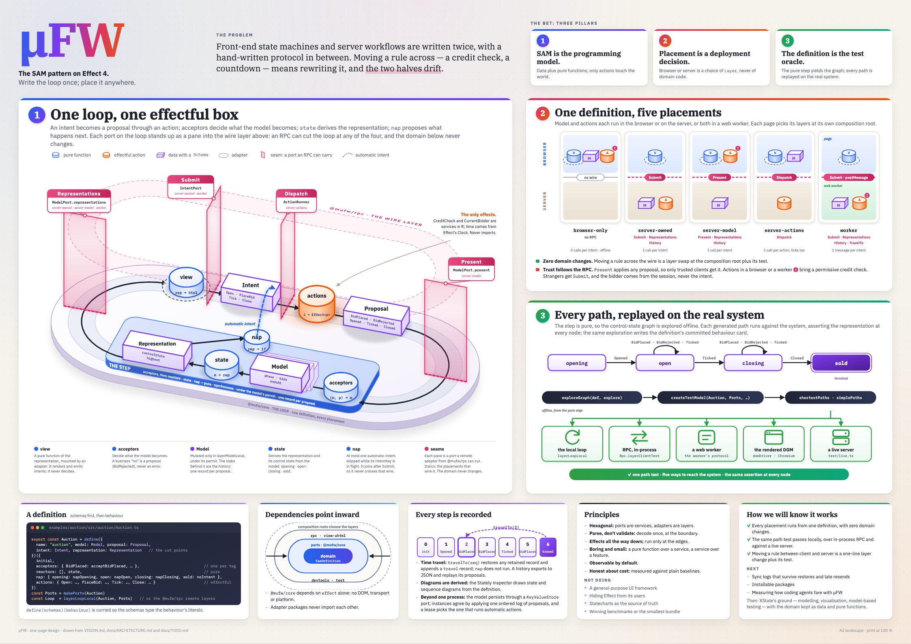
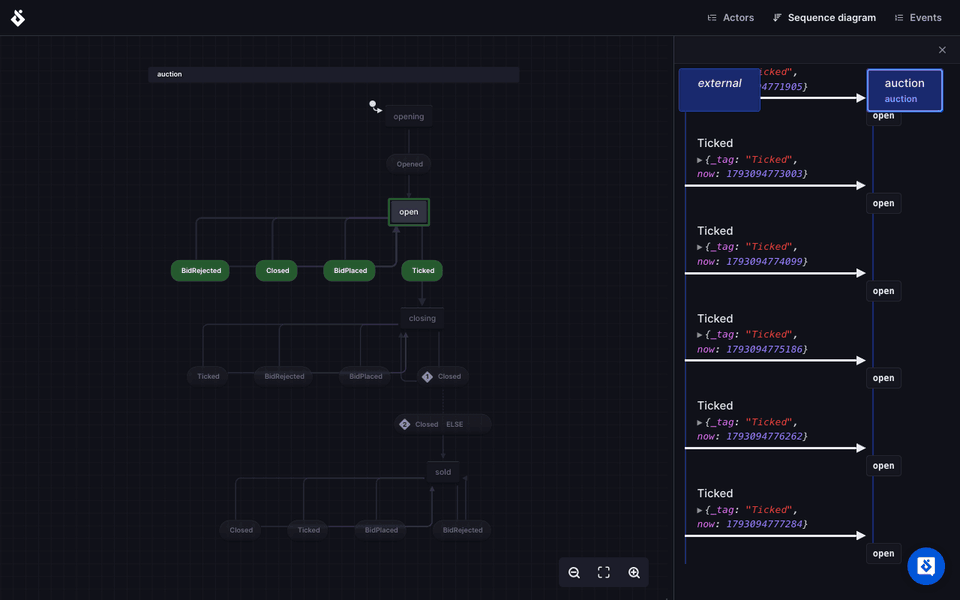

<h1>
  <picture>
    <source media="(prefers-color-scheme: dark)" srcset="docs/logo/lockup-dark.svg">
    
  </picture>
</h1>

[](docs/one-page.png)

µFW (`@mufw/*`) is a small TypeScript framework that implements the
[SAM pattern](https://sam.js.org/) (State–Action–Model) on [Effect 4](https://effect.website).
Which parts of the SAM loop run in the browser and which on the server is decided per deployment
by composing Effect `Layer`s; the domain code does not change.

**See it live:** [the showcase](https://microfw.pages.dev/), a presentation of µFW as a play in
eight acts, each running µFW in your browser.

Status: **proof of concept**. APIs move freely; the packages export their TypeScript sources, with no
build step, and nothing is published to npm.

## What you get

- **A pure SAM definition.** Model, proposals, intents and representation are Effect `Schema`s;
  acceptors, reactors, `state` and `nap` are pure functions; only actions are effectful.
- **Placement by layers.** The model and the actions can each be local or remote (Effect RPC),
  giving four browser/server placements of the same component, plus a fifth that runs both in a web
  worker, each its own deployment, against the same server code.
- **Time travel.** Every step is recorded; `travelTo(seq)` restores any recorded model. A history
  exports to and imports from JSON, and replays from any seq with its recorded proposals.
- **Model-based testing.** `@mufw/test` explores the control-state graph from the definition and
  replays each generated path against the real system, in-process or over the wire, or by clicking
  the rendered UI and reading the DOM. Each definition with an explore function also gets a committed
  behaviour card (`<Unit>.behaviour.md`), regenerated from the same exploration and kept current by a test.
- **Composition.** `nest` puts a child definition inside a parent, `compose` gives a parent named parts
  and keyed collections on one loop, and `layerForward` connects two loops on one page.
- **Server-side.** The model persists to a directory; several servers share one model through an event
  log, with a lease that picks the one instance that runs automatic actions; a server renders a page's
  first paint and streams a view as HTML with no client bundle.
- **Devtools.** A time-travel panel, a read-only history list, JSON export of a history, and an adapter for the
  [Stately inspector](https://stately.ai/docs/inspector) that draws the state and sequence diagrams.

  [](docs/stately-inspector.gif)

## What it costs

µFW trades bytes, load time and per-step work for a typed, recorded, relocatable loop. The figures
below are rounded from [performance.md](docs/architecture/performance.md), which holds each
measurement with its plain baseline, the machine it ran on and the command that regenerates it.

- **Bundle.** A counter page ships about 43 KiB of JavaScript gzipped, against about 3 KiB for the same
  page in plain uhtml; the `browser-only` auction ships about 74 KiB. Nine tenths of the bytes are
  Effect (runtime, `Schema`, streams, layers); µFW's own packages are a few KiB. That is about two
  thirds of a React hello world ([measured with another bundler](docs/architecture/performance.md#against-other-libraries)).
- **Startup.** First content takes two to two and a half times as long as in the plain page. Script
  time, where the extra JavaScript is parsed and run, is about three times as long for a 1000-row list
  and seven times for a counter.
- **Interaction.** A click reaches the screen as soon as in the plain page: click to next frame is
  within 2% of the baseline's at every CPU throttling rate measured. Browser pages run on
  `layerInputScheduler`, which runs the fiber hops of a click as microtasks in the click's own task
  (Effect's default scheduler posts each hop as a macrotask, which the browser holds until the next
  frame), and still yields to the event loop after 5 ms of work.
- **Against other frameworks.** In a local [js-framework-benchmark](docs/architecture/performance.md#against-other-frameworks)
  pass over 17 keyed entries, µFW is within about 5% of its plain uhtml 4 control on CPU, 10th of 17
  between Vue and Elm. It takes about 2.7 times the control's memory after creating and clearing rows,
  part of it the recorded history, and ten times its bytes, which about doubles its first paint.
- **Steps.** In Node a step costs a few microseconds over the reducer it runs and an intent's round
  trip about 30 more: fixed costs that dominate a step that is one addition and fade in one that does
  real work (3 times the reducer at 1000 rows).
- **Server.** One definition is one serialised writer: a few thousand proposals per second over
  websockets, which more connections do not raise. Every update sends the whole representation to
  every subscriber, so fan-out grows with updates times subscribers. History is bounded by count and
  by an estimate of the bytes it retains; the model is not. Synchronising adds a fraction of a
  millisecond on loopback, and a round trip to the host at a joiner on a real network.

## Packages

| Package | Role |
|---|---|
| `@mufw/core` | Definition, nesting and composition, pure step, ports, local layers, forwarding between definitions, graph exploration, history export and replay, model persistence; the `./sync` entry (`@mufw/core/sync`) holds event-log synchronisation, so a page that never syncs does not ship it |
| `@mufw/rpc` | Wire contract and remote adapters of the ports (platform-free) |
| `@mufw/view-uhtml` | Mounts a pure [uhtml](https://github.com/WebReflection/uhtml) v4 view (`layerMount`; `layerMountReadOnly` for an island that only reads the model); `makeKeyedList(htmlFor)`, a keyed list whose memo holds only the rows of the latest render, so a removed row's node is released; `layerInputScheduler`, the scheduler a browser page runs on so a click is rendered in its own task; the `./ssr` entry renders a view to markup in Node (`makeSsr`) |
| `@mufw/devtools` | Time-travel panel, history list, Stately inspector adapter |
| `@mufw/test` | Model-based path testing (returns Effects; test-runner agnostic) |
| `@mufw/example-auction` | A live auction running in all four browser/server placements and in a web worker |
| `@mufw/example-showcase` | A presentation of µFW as a theatre play: the deck is itself a SAM definition, and each act runs µFW live in the browser |
| `@mufw/example-jfb` | The js-framework-benchmark keyed table in µFW and in plain uhtml 4 (the control), built into directories a js-framework-benchmark checkout can serve |

## Quick start

Requires Node 24 and pnpm 12.

```sh
pnpm install
pnpm typecheck
pnpm test
```

Run the showcase (one terminal, no server), then open http://localhost:5180:

```sh
pnpm --filter @mufw/example-showcase dev
```

The showcase (`examples/showcase`) is a presentation of the features, and the presentation is µFW: the
deck (`src/deck/Deck.ts`) is a definition whose model is the act and cue on stage, with its own
time-travel panel, the prompter's book. Each act (`src/acts/<id>/`, listed in `src/acts/registry.ts`)
runs µFW live on the stage, over one shared box-office loop (`src/domain/BoxOffice.ts`). It is
browser-only; `examples/auction` stays the tech demo of the placements. Its domain tests are in
`examples/showcase/test` and run with `pnpm test`.

The showcase is published at https://microfw.pages.dev/ by Cloudflare Pages, which builds every
push to `main` from this repository (Git integration, configured in the Cloudflare dashboard, not in
the repository):

| Setting | Value |
|---|---|
| Root directory | the repository root (the build needs the workspace) |
| Build command | `pnpm --filter @mufw/example-showcase build` |
| Build output directory | `examples/showcase/dist` |
| Environment variables | `NODE_VERSION=24`, `PNPM_VERSION=12` (the build image defaults to Node 22 and pnpm 10, and reads neither version from `package.json` or the lockfile) |

The build is static: the deck routes by location hash, so the host needs no rewrites.

Run the auction example (two terminals):

```sh
pnpm dev:server   # demo server on :3001: websocket RPC at /sam/auction and /sam/wallet, every RPC served; the auction's Representations also over HTTP at /sam/auction/http
pnpm dev:client   # vite on http://localhost:5173
```

Each deployment is its own page, with its own entry point and its own composition of layers:

| Page | Model | Actions | RPCs it needs |
|---|---|---|---|
| `/browser-only.html` | browser | browser | none |
| `/server-owned.html` | server | server | `Submit`, `Representations`, `History` |
| `/server-model.html` | server | browser | `Present`, `Representations`, `History` |
| `/server-actions.html` | browser | server | `Dispatch` |
| `/devtools.html` | none | none | `History` (no view, wallet or local model: the server's history, read only, with a JSON export) |
| `/worker.html` | web worker | web worker | none from a server: its own worker serves `Submit`, `Representations`, `History`, `TravelTo`; needs only `pnpm dev:client` |
| `/` (demo) | picked at runtime from `?placement=model:server,actions:client` | | every RPC (`pnpm dev:server`), plus a read-only ticker over HTTP (`Representations`) and the HTML stream in an `<iframe>`, which need no `MUFW_RPCS` entry |

Query parameters: `?session=demo-bob` picks who a page bids as where the actions run on the server
(`server-owned`, `server-actions`); `?bidder=bob` does it where they run in the browser or in a web worker
(`browser-only`, `server-model`, `worker`); `?inspect=1` then **Open Stately inspector** shows the diagrams.
The footer of each page says which one it uses. The auction opens when its loop starts, reading the loop's `Clock`, and lasts 60
seconds. While it is `opening` the bid form is disabled and the page shows an **Open auction** button that
submits `Open`: after a `travelTo(0)`, or on a server with `MUFW_AUTO_ACTIONS=off`, nothing else
would reopen it, because `nap` does not run after a travel and its intents are dropped without automatic actions.

An intent never carries who is bidding. The server reads the session token the client sends with
every `Submit` and `Dispatch` (the `x-session-token` request header), looks it up and runs the
action as that bidder; a request without a valid session fails with a typed `Unauthenticated`
error, and a `server-owned` page (`?session=` unknown) shows it as a notice above the auction. The
demo sessions are fixed in `src/adapters/sessionsTable.ts`:

| Token | Bidder |
|---|---|
| `demo-alice` (default) | `alice` |
| `demo-bob` | `bob` |

A page whose server runs the actions also asks the server whose its session is: `Whoami` (read-only,
behind the same session check, `src/whoami.ts`) answers with the session's bidder, or fails with
`Unauthenticated` for a missing or unknown session. The server serves it whatever `MUFW_RPCS` says,
since it reveals only the caller's own identity; `MUFW_RPCS` does not list it.

Where the actions run in the browser there is no server to vouch for the bidder, and the server
applies whatever proposal the page presents anyway, so the page states its own identity from
`?bidder=` (default `alice`) at its composition root. A server that serves only `Submit`,
`Representations` and `History` never believes a visitor about who is bidding.

Every auction page (all but `/devtools.html`) also mounts a second island beside the auction: a wallet
(`src/wallet/Wallet.ts`, credit 100) with its own loop, root and placement, always in the browser.
`layerForward` feeds it from the auction: when the leading bid is the page's bidder's, the wallet
reserves its amount, and when another bidder leads it releases. The page's bidder is `?bidder=`
(default `alice`) where the actions run in the browser or in the web worker (`browser-only`,
`server-model`, `worker`); where they run on the server (`server-owned`, `server-actions`, the demo
with `actions:server`) it is the session's bidder, which the page asks the server with `Whoami`
(above). A session the server refuses leaves the wallet mounted and fed by nobody ("follows no
bidder"). The wallet is the visitor's own and the server trusts nothing from it. On the demo page,
`?placement=model:server,actions:server` runs the auction on the server and the wallet in the browser.

The demo page also mounts a read-only ticker beside the auction (`src/client/ticker.ts`): the server's
control state and highest bid into a view that has no `dispatch` and no intent port, so it cannot bid.
By default it is streamed over the server's HTTP endpoint (`RpcClient.layerProtocolHttp`, NDJSON,
`fetch`); `?ticker=socket` reads it over the websocket instead. It shows the server's auction, which is
the page's own only with `model:server` in `?placement=`. `pnpm --filter @mufw/example-auction compare:transports`
measures first paint and update latency of the socket, the HTTP endpoint and the HTML stream (below) in
headless Chromium against a server it starts itself, which is how the default was chosen.

The credit check (`alice` may bid up to 100, `bob` up to 1000) lives on the server. With actions in
the browser, the page brings a permissive check and the server applies whatever it presents, which
is how the example shows why that rule must run server-side.

The server is configured, not switched at runtime:

| Variable | Values | Default |
|---|---|---|
| `MUFW_RPCS` | comma-separated RPC tags to serve; the rest are not routed | `Submit,Representations,History` |
| `MUFW_AUTO_ACTIONS` | `on`, `off`: `off` never runs automatic actions; with `MUFW_SYNC`, `on` takes part in the lease that picks the one instance that runs them (below) | `on` |
| `MUFW_STORE` | a directory: the server loads the auction's model from it at start and writes it after every step (one file per key, `<directory>/auction`); with `MUFW_SYNC` it holds the instance's checkpoint instead (the log's id, the last applied sequence, the model, the lease) and, on the host, the log; a file that does not decode stops the server: delete `<directory>/auction` (or fix its JSON) and start again | unset: the model (and the host's log) lives in memory |
| `MUFW_SSR` | a built deployment: `demo`, `browser-only`, `server-owned`, `server-model`, `server-actions`; a bad value stops the server | unset: no page, no assets |
| `MUFW_PORT` | the port to listen on | `3001` |
| `MUFW_TLS_CERT`, `MUFW_TLS_KEY` | paths of a PEM certificate chain and its private key; the public listener then serves HTTPS, and a client picks HTTP/2 or HTTP/1.1 by ALPN, a websocket upgrading over HTTP/1.1 on the same port; one without the other stops the server (the event-log listener of `MUFW_SYNC=host` stays plain HTTP) | unset: plain HTTP/1.1 |
| `MUFW_SYNC` | `host`: this instance serves the event log at `/eventlog` on its own listener (`MUFW_SYNC_PORT`) and joins it; `ws://<host>:<sync port>/eventlog`: this instance joins the log of that host; with either the server refuses `TravelTo` and `Replay` in `MUFW_RPCS`; `MUFW_STORE` makes the log (host) and the instance's checkpoint survive a restart | unset: one instance |
| `MUFW_SYNC_PORT` | with `host`: the port of the event-log listener; it must differ from `MUFW_PORT` | `3101` |
| `MUFW_SYNC_HOST` | with `host`: the interface the event-log listener binds; whoever reaches it can append any proposal, so set it only to a private interface | `127.0.0.1` |
| `MUFW_SYNC_CUT_EVERY` | with `host` and `MUFW_STORE`: an integer of at least 1; the host replaces the entries of its log by a snapshot of the model once this many have been applied since the last snapshot, so the log stays short; a host without a store keeps its log in memory and never cuts | `1000` |

`pnpm start:server` runs with the defaults, which are what `/server-owned.html` and `/devtools.html`
need; `pnpm dev:server` serves every RPC, so every page that needs a server works (`/worker.html` needs none).

Whatever `MUFW_RPCS` says, the server also serves `Representations` and nothing else over HTTP at
`POST /sam/auction/http`, as NDJSON: one line per representation, for as long as the request stays open
(`RpcServer.layerProtocolHttp`, `src/httpRoutes.ts`). It is open to any origin (CORS) because it only reads.
The request is one NDJSON line, so it must end with a newline (`curl --data` strips it and the server
then answers with an empty body):

```sh
printf '%s\n' '{"_tag":"Request","id":"1","tag":"Representations","payload":null,"headers":[]}' |
  curl -N -X POST http://localhost:3001/sam/auction/http -H 'content-type: application/ndjson' --data-binary @-
```

With `MUFW_STORE` the model survives a restart, the history does not: it starts again from the stored
model. Only the newest model is written, to `<directory>/auction.tmp` and then renamed onto
`<directory>/auction`, so a crash never leaves a truncated file. The file is synced before the rename
and the directory after it, so a write that has succeeded survives a power loss. Stopping the server
waits for the write in flight; a crash can lose that write and the newest pending model, never more.
Run one server per directory (with `MUFW_SYNC` too: see below).

With `MUFW_SYNC` several servers run the auction and agree on it: a bid accepted on one is on all, in
one order. The host and the instances that join it exchange proposals through an event log
(`effect/eventlog`, one store per definition): a server never applies a proposal it produces itself, it
appends it to the log, and every server, the producer included, applies the log's entries in the log's
order. Run two servers and watch a bid on one reach the other:

```sh
MUFW_SYNC=host pnpm start:server                                                      # :3001; event log on 127.0.0.1:3101
MUFW_PORT=3002 MUFW_SYNC=ws://127.0.0.1:3101/eventlog pnpm start:server                # joins
pnpm --filter @mufw/example-auction test:sync   # MUFW_SERVER, MUFW_SERVER_2 override ws://localhost:3001, ws://localhost:3002
```

The check needs a fresh auction (start the servers anew), bids as `alice` on the first server and as
`bob` on the second at the same time, and fails unless both end with the same bids in the same order.
Automatic actions run on one instance at a time (the lease, below): each instance computes the same
next tick from the same model, so only the instance that holds the lease runs it. An instance that starts later replays the
log before it serves, so it shows the auction as the others do (with `MUFW_STORE` it replays only the
entries after its checkpoint); started while its host is unreachable, it accepts connections and
answers none until it reaches the host. A bid whose connection to the log drops is sent again until
the log has it, never twice. The log's endpoint accepts any writer that sends a proposal, with no
session and no credit check: it is served on a port of its own, on `127.0.0.1` unless
`MUFW_SYNC_HOST` says otherwise, and must stay reachable from the other instances only.

`MUFW_STORE` combines with `MUFW_SYNC`, and each instance needs a directory of its own. On the host it
holds the log itself (the files `auction%2Flog%2Fid` and `auction%2Flog%2F<n>`: an id and the entries,
256 to a file) and its checkpoint, so a restarted
host serves the same log and the joiners that stayed up go on; on a joiner it holds the checkpoint
(`<directory>/auction`: the log's id, the last applied sequence, the model and the lease), so a restarted joiner
reads only what came after. Without `MUFW_STORE` the host's log lives in memory: a restarted host
starts a new log, and a running joiner that finds it logs `sync log replaced` and stops (exit code 1);
start it again to join the new log. A stored checkpoint of another log, a checkpoint written without a
lease, or a bare model stored by an
instance without `MUFW_SYNC`, stops the server at start without being overwritten: delete
`<directory>/auction` and start again. So does a checkpoint past the end of its host's log (the
host's store lost its newest entries): the instance logs that the log ends before its checkpoint and
stops with `SyncLogBehind`, and no entry is written to that log; delete `<directory>/auction` to join
again from the first entry. The host with a store keeps its log short: every `MUFW_SYNC_CUT_EVERY`
entries it replaces the oldest ones by a snapshot of the model, and an instance that starts from
nothing (a joiner with no store, or one whose checkpoint is behind the cut) starts from that
snapshot instead of replaying every entry. `pnpm --filter @mufw/example-auction test:sync:restart`
starts a host and a joiner of its own, each with a store, on ports 3211, 3311 and 3212, restarts them
in turn and checks all of this, including a host restarted over a store that lost its entries and a
joiner with no store that starts from the host's snapshot.

Only one instance at a time runs the automatic actions, and the log decides which. Each instance with
`MUFW_AUTO_ACTIONS=on` (the default, the host and the joiners alike) takes part in a lease kept in the
log: the first to start against a log nobody has claimed takes it and ticks, the others compute the
same next tick and drop it. The holder renews the lease every 5 seconds; an instance that has seen no
renewal for 15 seconds takes the lease over and ticks from the state the auction is in, and the old
holder, if it was only cut off, stops its automatic actions the moment it reads the entry that took the
lease away. A tick it had finished by then, if it reaches the log after the takeover, is skipped by
every instance: the entry stays in the log and changes no model. `MUFW_AUTO_ACTIONS=off` is an instance that never ticks and never claims. An instance that
restarts holds nothing until it wins the lease again, so a lone instance resumes ticking 15 seconds
after it restarts. The host carries the log: if it stops, the joiners stop with it. `pnpm --filter
@mufw/example-auction test:sync:failover` starts a host that never ticks and two joiners of its own on
ports 3221, 3321, 3222 and 3223, kills the joiner that holds the lease and checks that nothing ticks
until the lease has timed out, then that the other joiner ticks and the host shows the same auction.

With `MUFW_SSR` the server also renders the page's first paint, so it is visible before the socket
connects (the bundle then takes over: it renders again over the server's markup, which differs only
in the amount input's value, a property the server cannot write; an event before it mounts does
nothing, because the bid form is `method="dialog"`):

```sh
pnpm build:client
MUFW_SSR=server-owned pnpm start:server   # then open http://localhost:3001/ (or curl it)
```

`GET /` is the built page of that deployment with the auction view already rendered from the
server's current model (`?bidder=` and `?session=` change its footer, as in the browser), and
`GET /assets/*` its built assets. For `browser-only`, `server-actions` and `demo`, whose browser owns
the model, the page also embeds the server's model as `<script type="application/json" id="mufw:auction">`
and the browser starts from it, so its first bids are the server's.

The server also streams the auction's view as HTML, with no client bundle, whatever `MUFW_RPCS` and
`MUFW_SSR` say (it only shows what `Representations` shows):

```sh
pnpm dev:server
curl -N http://localhost:3001/stream/auction   # the document, then a chunk after each change
```

`GET /stream/auction` answers with a response that never ends: first the server-rendered document, then,
for each new representation, a `<template>` and a one-line script that swaps it into `#app`. Open it in
a browser to watch the auction update with no script of the page's own; the controls are disabled
(a `<fieldset disabled>`), so it cannot bid. The demo page embeds it in an `<iframe>`; any other name
answers 404.

Over HTTP/1.1 a browser opens at most six connections to an origin, and every open island holds
one for as long as it lives: the HTML stream of an `<iframe>` and an HTTP ticker each keep a response
open, so a few demo tabs on one origin leave the next ones with blank islands. Over HTTP/2 they are
streams of one connection. Browsers speak HTTP/2 only over TLS, so the server serves it when it is
given a certificate, and plain HTTP/1.1 otherwise:

```sh
brew install mkcert   # once; other systems: https://github.com/FiloSottile/mkcert#installation
mkcert -install       # once: trusts mkcert's local authority in the system and browser stores (asks for your password); restart the browser afterwards
pnpm cert             # examples/auction/.certs/localhost.pem and localhost-key.pem, ignored by git
MUFW_TLS_CERT=$PWD/examples/auction/.certs/localhost.pem MUFW_TLS_KEY=$PWD/examples/auction/.certs/localhost-key.pem pnpm dev:server
VITE_SERVER_URL=wss://localhost:3001 pnpm dev:client   # the pages read the server as wss:// and https://
curl -N --http2 https://localhost:3001/stream/auction  # add --cacert "$(mkcert -CAROOT)/rootCA.pem" where curl does not use the system store
```

The HTTP routes (`GET /`, `/assets/*`, `/stream/<name>`, `POST /sam/auction/http`) are served over
HTTP/2 to a client that offers it and over HTTP/1.1 to one that does not. The websocket is not an
HTTP/2 stream: it upgrades over HTTP/1.1 on the same port, so it is a connection of its own. That
does not count against the six: Chromium keeps websockets in a pool of their own, with 255
connections per origin, and Firefox allows 200 (see [placement.md](docs/architecture/placement.md#connections-and-http2)).
`test:live` over TLS needs the same trust: `MUFW_SERVER=wss://localhost:3001 NODE_EXTRA_CA_CERTS="$(mkcert -CAROOT)/rootCA.pem"`.

The client is built per deployment, not as one bundle:

| Command | Does |
|---|---|
| `pnpm build:client` | one `vite build --mode <deployment>` per page into `examples/auction/dist/<deployment>` (`browser-only`, `server-owned`, `server-model`, `server-actions`, `devtools`, `worker` with its worker file in `assets/`, and `demo` with all four browser/server placements), then `check:bundle` |
| `pnpm --filter @mufw/example-auction check:bundle` | first fails on a module under `src/client` other than `placements/auctionLocal.ts` that calls `layerModelLocal`, `layerActionRunnerLocal` or `layerLoopLocal` with the auction's definition (a source scan, also run by `pnpm test`); then fails if a page that imports only the local loop (`scripts/bench/pages/counter-mufw.ts`) bundles a module of `effect/eventlog` or `effect/encoding` beyond the ones `Schema` itself needs; then fails if a deployment ships a local half of the auction it should not (the four fixed pages' expectations come from `placements` in `src/deployments.ts`, the table the footers read too: a `server-owned` bundle with its local model or action runner; a `devtools` bundle with any of them, the auction view, the wallet or the travel panel; a `worker` page bundle with any of them, or whose worker file holds the wallet or the view) or lacks one it should; every bundle but `devtools` keeps the wallet's local loop |
| `pnpm --filter @mufw/example-auction compare:transports` | starts a server of its own on a free port from 4700 to 4799, builds and serves the two bundled ticker pages, and prints first paint and update latency (median, p95) and client JS size for the websocket, HTTP (NDJSON) and HTML stream in headless Chromium; needs `pnpm exec playwright install chromium` once; `MUFW_COMPARE_LOADS`, `MUFW_COMPARE_UPDATES`, `MUFW_COMPARE_WARMUP` set the sample sizes |
| `pnpm --filter @mufw/example-auction bench:bundle` | builds in memory, minified, the Effect floors, the four bench pages (`scripts/bench/pages/`: a counter and a 1000-row list, each in plain uhtml and in µFW) and every deployment, and prints raw, gzip and brotli size per entry, the minified size per origin (Effect module, `@mufw/*`, uhtml, Stately, app) and the 20 largest modules |
| `pnpm --filter @mufw/example-auction bench:loop` | in Node, the cost of one step (plain reducer, `applyProposal`, `ModelPort.present`, `IntentPort.dispatch` to its record) for the bench counter, the bench list and the auction, concurrent presenters, representation subscribers, schema and JSON boundary costs, heap per history record; `BENCH_SECONDS`, `BENCH_OPS`, `BENCH_WARMUP_SECONDS` |
| `pnpm --filter @mufw/example-auction bench:browser` | builds and serves the bench pages and `browser-only`, and prints cold first content, script time, heap, click→DOM and click→next frame in headless Chromium at each CPU throttling rate in `BENCH_CPU_RATES` (default `1,4`), with the µFW/uhtml ratios; ports 4600–4699; `BENCH_LOADS`, `BENCH_INTERACTIONS`, `BENCH_WARMUP` |
| `pnpm --filter @mufw/example-auction bench:server` | starts servers of its own on ports 4800–4999 and prints `Present` and `Submit` throughput and latency over websockets with 1 to 200 connections, `Representations` fan-out to up to 1000 subscribers, server RSS as history fills, and the latency a synced host and joiner add; `BENCH_SECONDS`, `BENCH_SCENARIOS`, `BENCH_PRESENTERS`, `BENCH_SUBMITTERS`, `BENCH_SUBSCRIBERS`, `BENCH_MEMORY_STEPS`, `BENCH_SYNC_BIDS` |
| `pnpm --filter @mufw/example-jfb build` | builds the js-framework-benchmark keyed table twice, as µFW (`mufw`) and as plain uhtml 4 (`uhtml4`, the control), into `examples/jfb/out/keyed/<name>`, each shaped like a built `frameworks/keyed/<name>` directory of [js-framework-benchmark](https://github.com/krausest/js-framework-benchmark); prints the size of each `dist/main.js` |
| `pnpm --filter @mufw/example-jfb jfb:install <jfb-checkout>` | copies both built directories into `<jfb-checkout>/frameworks/keyed/`, replacing them |
| `pnpm --filter @mufw/example-jfb jfb:table <results-dir>` | prints the CPU, memory, size and first-paint tables, and one comparison table, of a directory of js-framework-benchmark result files; `examples/jfb/results/` holds the pass reported in [performance](docs/architecture/performance.md#against-other-frameworks) |

Each build has a single entry, so a `server-owned` bundle holds no local model or action runner of
the auction, the permissive credit check is only in builds that run actions in the browser or in a worker, and the
credit table is in no client bundle. The server's websocket origin is a build-time setting:
`VITE_SERVER_URL`, default `ws://localhost:3001` from `examples/auction/.env`, without a path (each
definition is served at `/sam/<name>`, the auction at `/sam/auction`); override it per deployment in
`.env.<deployment>` or in the environment (`VITE_SERVER_URL=wss://auction.example pnpm build:client`).

Replay the model-based paths against a live server:

```sh
MUFW_AUTO_ACTIONS=off pnpm dev:server
pnpm --filter @mufw/example-auction test:live   # MUFW_SERVER (the origin) overrides ws://localhost:3001
```

The live test replays the paths over `Present`, then submits `Open` and a bid with the `demo-alice`
session and checks the accepted bid is alice's, and that a client with no session is refused. The path
tests travel to seq 0 and expect `Auction.initial` there, so run the live test against a server started
without `MUFW_STORE`, or with an empty store directory: a stored model is seq 0 of a restarted server.

The server serves a second definition, the example's wallet, at `/sam/wallet` under the same
`MUFW_RPCS`. It is one in-memory model of its own that no page reads (the pages keep their wallet in the browser), never
stored or synced. Replay its paths over `Present` against a running server:

```sh
pnpm --filter @mufw/example-auction test:live:wallet   # MUFW_SERVER overrides ws://localhost:3001
```

Any freshly started server has `Wallet.initial` at seq 0; `MUFW_AUTO_ACTIONS` and `MUFW_STORE` do not matter to it.

The example's path tests also replay through the rendered view with `domDriver`: on uhtml's fake
DOM inside `pnpm test`, and in headless Chromium with

```sh
pnpm exec playwright install chromium   # once
pnpm test:browser
pnpm test:browser:ui                    # visible Chromium, steps slowed down, watch mode
```

## A definition, in short

```ts
import { Effect, Option, Schema } from "effect"
import { define, layerLoopLocal, makePorts, noIntent } from "@mufw/core"

export const Counter = define({
  name: "counter",
  model: Schema.Struct({ count: Schema.Int }),
  proposal: Schema.Union([Schema.TaggedStruct("Incremented", { by: Schema.Int }), Schema.TaggedStruct("Reset", {})]),
  intent: Schema.Union([Schema.TaggedStruct("Increment", { by: Schema.Int }), Schema.TaggedStruct("AutoReset", {})]),
  representation: Schema.Struct({ controlState: Schema.Literals(["low", "high"]), count: Schema.Int })
})({
  initial: { count: 0 },
  acceptors: {
    Incremented: (model, proposal) => ({ count: model.count + proposal.by }),
    Reset: () => ({ count: 0 })
  },
  reactors: [],
  state: (model) => ({ controlState: model.count >= 3 ? "high" : "low", count: model.count }),
  nap: {
    low: noIntent,
    high: () => Option.some({ _tag: "AutoReset" })
  },
  actions: {
    Increment: (intent) => Effect.succeed({ _tag: "Incremented", by: intent.by }),
    AutoReset: () => Effect.sleep("1 second").pipe(Effect.as({ _tag: "Reset" }))
  }
})

const Ports = makePorts(Counter)
const Everything = layerLoopLocal(Counter, Ports)      // or swap in @mufw/rpc's remote layers
```

`acceptors` is a record with one entry per proposal tag (`Tag: unchanged` for a tag the definition
ignores) and `nap` a record with one entry per control state (`noIntent` for a state with no
automatic intent). `define` types both from the schemas and compiles them into the `SamDefinition`
every consumer reads, with `controlStates` derived from `nap`'s keys, so a missing or extra acceptor
key, or a missing `nap` key, does not compile.

`nest(parent, child, options?)` composes two definitions into one (a wizard around a form): the
model is `{ parent, child }`, the child's proposals and intents are wrapped as `{ _tag: "Child", … }`,
and `toChild`/`toParent` forward a proposal to the other side in the same step. See
[the SAM loop](docs/architecture/sam-loop.md#nested-definitions).

`compose(parent, (part) => parts, options?)` composes a parent with named parts on one loop: a
slot (`part.slot(child)`, one instance) or a keyed collection (`part.collection(child, { keys })`,
one instance per key the parent's model lists, created and dropped as the list changes). The model
is `{ parent, parts }`; a part's proposals and intents travel as `{ _tag: "<Part>", proposal }`, or
with a `key` for a collection; `nap` offers every part's automatic intent in the same step, keyed
per instance, and the history labels a step with the instance (`Rows[b]/Inc`). See
[the SAM loop](docs/architecture/sam-loop.md#composed-definitions).

`layerForward(from, to, forward)` connects two definitions on one page: every representation of
`from` goes through the pure `forward(previous, current)`, and each intent it returns is dispatched
through `to.IntentPort`. Each definition keeps its own loop, root and placement.

## Documentation

These are living documents: they are updated in the same change that makes them false.

- [VISION.md](VISION.md) — why µFW exists and where it is going
- [docs/one-page.html](docs/one-page.html) — the design on one A2 sheet (print at 100 %, landscape),
  built from [docs/one-page/](docs/one-page/) with `python3 docs/one-page/build.py`, which also
  renders the image at the top of this page (`docs/one-page.png`; needs
  `pnpm exec playwright install chromium` once)
- [docs/ARCHITECTURE.md](docs/ARCHITECTURE.md) — how it is built, with the detailed pages under
  [docs/architecture/](docs/architecture/)
- [docs/TODO.md](docs/TODO.md) — known gaps
- [docs/logo/](docs/logo/README.md) — the logo: mark, lockups, favicon, app icon, their colours and
  geometry
- [AGENTS.md](AGENTS.md) — rules for anyone (human or agent) changing the code
