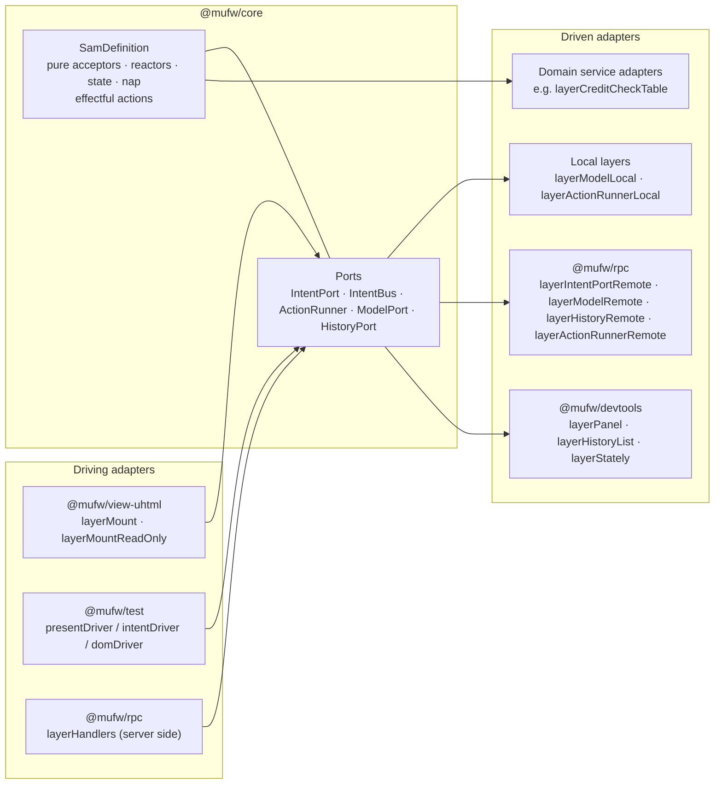
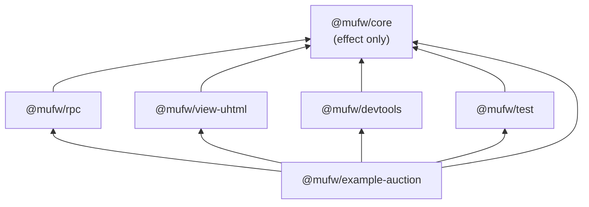

# Architecture

Living document: change it in the same commit that changes what it describes. Detailed pages:

- [architecture/sam-loop.md](architecture/sam-loop.md) — definition, step, automatic actions, history, travel and replay, persistence, synchronisation across instances, nested definitions
- [architecture/placement.md](architecture/placement.md) — ports, layers, the RPC contract, the placements (browser, server, web worker)
- [architecture/testing.md](architecture/testing.md) — graph exploration and model-based path testing
- [architecture/devtools.md](architecture/devtools.md) — time-travel panel, history list and export, Stately adapter

## Shape of the system

µFW is a hexagon around one SAM definition.

| Hexagonal term | µFW |
|---|---|
| Domain | The `SamDefinition`: schemas plus pure acceptors, reactors, `state`, `nap` |
| Application services | The definition's `actions`: the only effectful part, they turn intents into proposals |
| Driving ports | `IntentPort.dispatch`, `ModelPort.present` |
| Driven ports | `ActionRunner`, `ModelPort`, `HistoryPort`, `KeyValueStore` (model, checkpoint and event-log persistence), `SyncLog` (the ordered log several instances share), and domain services the actions require (`CreditCheck`, `CurrentBidder`); a page's `Whoami` |
| Driving adapters | the uhtml view, test drivers, RPC handlers on the server, the authentication middleware in front of them |
| Driven adapters | local layers, remote RPC layers, `KeyValueStore.layerMemory`, the example's `layerAtomicFileStore` (synced temp file + rename + synced directory over `layerFileSystem`), `layerSyncStorage` (the event-log `Storage` over a `KeyValueStore`), `layerCreditCheckTable`/`layerCreditCheckPermissive`, `layerSessionsTable`, `layerCurrentBidderFixed`, `layerWhoamiFixed`/`layerWhoamiRemote`, devtools |
| Composition roots | one per deployment: `examples/auction/src/client/<page>.ts`, `client/auctionWorker.ts`, `server.ts`, `test/live.ts`, `test/walletLive.ts` |

Ports are Effect service keys (`Context.Service`) created per definition by `makePorts(def)`;
adapters are `Layer`s. Choosing a placement is choosing layers in a deployment's composition root;
only the demo page chooses at runtime.

## Packages and dependency direction

- `@mufw/core` depends on `effect` alone and contains no platform, DOM or transport code.
- `@mufw/rpc` defines the wire contract and remote adapters but no transport; the application
  picks the protocol (websocket, HTTP, worker) and the serialization.
- Adapter packages never depend on each other.
- Platform packages (`@effect/platform-node`, `@effect/platform-browser`) appear only in the example.

Packages are consumed as TypeScript sources (`exports: { ".": "./src/index.ts" }`); vite, vitest and
tsx compile them on the fly. There is no build step.

## Where effects are run

Code stays inside `Effect`/`Stream`/`Layer` across every package. Effects are run only here:

| Boundary | Where | How |
|---|---|---|
| Browser page | `examples/auction/src/client/app.ts` (`runPage`, called by each page's entry point) | `BrowserRuntime.runMain(Layer.launch(page))` |
| Browser island | `examples/auction/src/client/ticker.ts` (`runTicker`, called by the demo page's entry point) | `BrowserRuntime.runMain(Layer.launch(ticker))` |
| Devtools page | `examples/auction/src/client/devtools.ts` | `BrowserRuntime.runMain(Layer.launch(page))` |
| Stream frame | `examples/auction/src/client/streamEmbed.ts` (`runStreamFrame`, called by the demo page's entry point) | `BrowserRuntime.runMain(show)` |
| Node server | `examples/auction/src/server.ts` | `Layer.launch(...).pipe(Effect.raceFirst(Deferred.await(syncStopped)), NodeRuntime.runMain)`: a synced instance whose log was replaced stops the process |
| Web worker | `examples/auction/src/client/auctionWorker.ts`, the worker's composition root | `BrowserRuntime.runMain(Layer.launch(workerHost.pipe(Layer.provide(BrowserWorkerRunner.layer))))` |
| Live tests and scripts | `examples/auction/test/live.ts`, `test/walletLive.ts`, `test/syncLive.ts`, `test/syncRestartLive.ts`, `test/syncFailoverLive.ts`, `scripts/*.ts` | `NodeRuntime.runMain(program)` |
| DOM events | `layerMount` dispatch, `layerPanel` and `layerHistoryList` row click and export click | `FiberSet.makeRuntime` captured in the layer: the fiber inherits the layer's services and references and is interrupted with its scope |
| Tests | every `*.test.ts` | `@effect/vitest` `it.effect` |

## Data at the edges

Every cut point of the loop is a `Schema`: model, proposal, intent, representation and the history
record (`stepRecordSchema`). RPC decodes and encodes with them, so a value that crosses the wire
arrives as a domain type or not at all. Business rejections are proposals (`BidRejected`), not
errors; technical failures are typed errors (`ActionFailure`, `NoSuchStep`). A call made while the
transport is down is held until it returns and is then sent once, however many times the connection
drops before it is written; the page learns how many calls wait from `HeldRequests`, data outside
the representation, while the call itself waits with no deadline and the domain sees nothing; a call
already written when the transport drops, which the server may have run, is a defect; the remote
streams resubscribe (see [placement](architecture/placement.md)).

## Decisions

Each entry states the choice and the constraint behind it.

- **`define(schemas)(behaviour)` is curried.** TypeScript only types the behaviour's literals
  (`_tag`, control states) from the schemas once the schemas are fixed by a first call; a single
  call widens them to `string`.
- **Ports are function-style service keys with per-definition identifiers** (`IntentBus<D>` …),
  so their types can be named and the same framework can host several definitions.
- **Placement is per deployment, not per request.** Each page has its own entry point that calls
  one placement module; the server's served RPCs come from `Config`. A placement chosen by the
  visitor would let the visitor choose what the server trusts.
- **Several definitions on one page are islands joined by `layerForward`, not one merged loop.**
  Each has its own `makePorts(def)` keys (prefixed with `def.name`, so distinct names are
  required), loop, root and placement; the example's wallet is always in the browser while the
  auction may be on the server. `layerForward(from, to, forward)` reads `from.ModelPort`
  representations and dispatches through `to.IntentPort`, so neither side knows where the other
  runs, and a refusal, or a defect in `forward` or in the dispatch, is logged, not thrown. `forward` is pure and sees the previous
  representation, so what counts as a change is the caller's rule. (`nest` is the alternative for
  one loop, one history.)
- **One websocket path per served definition (`/sam/<name>`), not a definition tag in the wire
  contract.** The RPC tags stay `Submit`…`Replay`; a client builds one protocol and one socket
  per remote definition, and `MUFW_RPCS` applies to every definition the server serves. The server
  serves two, the auction and the wallet, each with its own loop, `RpcServer.layer` and path, in one
  `HttpRouter.serve`: nothing collides because ports, client keys and handlers are per definition
  (`makePorts` prefixes by `def.name`). The served wallet is a separate in-memory instance that no
  page reads, since the pages keep theirs in the browser.
- **A server that owns the actions receives intents (`Submit`), not proposals.** Serving `Present`
  to an untrusted client lets it apply any proposal and bypass every rule enforced by the actions.
- **`Dispatch` returns the proposal and the caller presents it.** It serves a client-side model with
  server-side actions; actions never need to know where the model is.
- **`IntentPort` is separate from `IntentBus`.** The view only submits intents; with the actions on
  the server there is no local queue to put them in. Its `dispatch` fails with `DispatchRefused`
  when the server refuses the caller; only a lost transport is a defect, in `@mufw/rpc`.
- **The model is persisted through a `KeyValueStore` port, by composition.** `layerLoopPersisted`
  decodes the stored model once with `def.model` (a `SchemaError` stops the layer rather than
  falling back to `def.initial`, which the next step would overwrite), starts `layerLoopLocal` from
  it and adds `layerPersistModel`, a fiber that writes the model of every `step` and `travel` record
  read from `HistoryPort`. `layerModelLocal` and the step stay pure and unaware of storage, and a
  write happens after the permit is released, so a slow store never slows a step. Durability is last
  write wins, and the store decides what a crash or power loss leaves: the example's file store syncs
  the file and its directory before it reports a write (see [the SAM loop](architecture/sam-loop.md#persistence)). The
  implementation (memory, files) is chosen at the composition root (`MUFW_STORE` in `server.ts`); an
  instance of a synced loop persists a checkpoint instead, see below.
- **Several instances agree through an ordered log that is the only way a proposal reaches a model.**
  Acceptors need not commute, so instances must apply the same proposals in the same order.
  `layerLoopSynced` makes `ModelPort.present` append the proposal to a `SyncLog` and wait until the
  log has delivered it back and the instance has applied it; every instance, the producer included,
  applies the log's entries in the log's order through a local model only the applier reaches, so
  an entry read from the log is never written back (no echo) and model mutation stays in
  `layerModelLocal` under its permit. `effect/eventlog` provides the log and its order, the server's
  arrival order; its `EventLog` runtime is not used, because it applies a writer's entry at once and
  resolves conflicts afterwards by clock-based ids, which would need the acceptors to commute.
  Actions run where the intent arrived; only proposals travel. The log applies any proposal that
  decodes, as `Present` does, so it is served only to trusted instances. Core holds the mechanism,
  the server over any event-log `Storage` and a `Storage` over a `KeyValueStore` (effect only); the
  socket client, the listener and the choice of store are the example's (`MUFW_SYNC`, `MUFW_STORE` in
  `server.ts`, `src/sync.ts`). Catch-up, the automatic-actions rule and what breaks convergence are in
  [the SAM loop](architecture/sam-loop.md#synchronisation-across-instances).
- **A log has an identity, and what is kept next to a sequence names the log.** Sequences mean
  something within one log only. The server's `Storage` id, generated when the log is created and kept
  with it, is the log's `LogId`; a subscription reports it, and an instance that finds another log
  than the one it joined (or than the one its stored checkpoint names) applies nothing from it and
  stops with `SyncLogMismatch`. It does not replay the new log over its model: a running replica
  cannot be reset, and a stored model is not discarded without saying so, as a stored value that does
  not decode is not replaced by `def.initial`.
- **Which instance runs the automatic actions is decided by the log, as a lease, not by configuration.**
  `nap` runs on every instance, so something has to say which one runs its intents. A `Lease { epoch,
  holder }` entry, next to `Proposal` and `Joined`, claims or renews it; every instance applies lease
  entries in log order by one compare-and-set rule (a claim wins only for the epoch after the current
  one), so they agree on the holder at each position of the log without agreeing on a clock. Only the
  holder's actions drain runs automatic intents (`AutoActionsGate`); an instance that stops hearing the
  holder for a timeout, by its own `Clock`, claims the next epoch, and the one that loses the lease
  interrupts its automatic actions in flight, as `travelTo` does. `AutoActions` true means an instance
  takes part, false that it never ticks. The lease state is in the checkpoint, since a resumed instance
  reads only the entries after it, and the instance's identity is new with each layer, so a restarted
  instance never believes it holds a lease its earlier run held. The rule does not fence the proposal
  of a holder that has not yet heard it was deposed. See
  [the lease](architecture/sam-loop.md#the-lease).
- **The log persists in the host's `Storage`, an instance persists a checkpoint, both through a
  `KeyValueStore`.** `layerSyncStorage` stores the log (id, entries) so a host restart keeps it;
  `layerLoopSyncedPersisted` stores `{ log, sequence, model, lease }`, decoded once with a `Schema`, so a
  restarted instance resumes from the model at `sequence` and reads only the entries after it.
  `layerLoopSynced` stays unaware of storage: it offers each checkpoint to a sliding queue that a
  separate fiber writes after the permit, as `layerPersistModel` does. A model restored from elsewhere
  is still not the log's; a checkpoint is, for the log it names. Persistence and `MUFW_SYNC` combine
  in the example; each instance has a store of its own.
- **Domain services are ports; their implementations are adapters in separate modules**
  (`CreditCheck` vs `layerCreditCheckTable`), so a browser bundle never contains server secrets.
- **Identity is a port, not part of the intent.** `PlaceBid` carries an amount; the action reads
  `CurrentBidder`. A server provides it per request from a session token (RPC middleware on
  `Submit` and `Dispatch`), so a client cannot name the bidder; a page that runs its own actions
  provides it at its composition root, because there the browser is trusted with the model anyway.
- **A page learns its own identity through a port too, `Whoami`, so an island that depends on it
  needs no claim from the page.** Where the server runs the actions the page asks it: a read-only
  RPC behind the same middleware, answering with the `CurrentBidder` the middleware provided, or
  failing with `Unauthenticated`. It is the example's contract (`src/whoami.ts`), not `SamRpcs`:
  identity is not part of the generic wire contract. A server serves it whatever `MUFW_RPCS` says,
  because it reveals only the caller's own identity and no RPC that changes anything; where the
  actions run in the browser the page names its bidder itself (`layerWhoamiFixed`). The wallet
  follows what `Whoami` says. See [placement](architecture/placement.md#identity).
- **The dispatcher's services travel with the intent, and are typed.** The bus queue would drop a
  request's context; `IntentEnvelope.context` carries it to the action, generically, so core knows
  nothing of authentication. `Ports<D, R>` puts the per-request services `R` in the `R` of the
  effects that carry an intent, so a dispatcher without them does not compile, and
  `layerLoopLocal` does not require them when built. Services captured when a layer is built win
  over the caller's, and automatic intents carry none.
- **A refused dispatch reaches the page as data, apart from the representation.** `layerMount`
  hands a `DispatchRefused` to its `onRefused` effect; the example reports it into a `Refusals`
  service that a notice layer renders, so the domain and the SAM representation stay unaware.
- **The session token is a request header, not a connection property.** A browser websocket cannot
  set headers, but an RPC request can, so the client middleware adds the token to each request and
  one connection could serve several identities.
- **The RPC client is a service (`Client<D>`) shared by the remote ports**, provided either
  over a transport (`layerClient`) or in-process (`layerClientTest`, backed by `RpcTest`).
- **The RPC group is typed by hand (`SamRpcs<D>`).** Inferring it through a generic `D` widens the
  schemas to `any`, which leaks `any` into the services every server layer requires.
- **An automatic action's key is released when the action has its proposal, before presenting.**
  The `nap` of that very step must be able to start the next round, or a tick loop can stop.
- **A travel interrupts automatic actions in flight, in the bus the model emitted them on.**
  Tagging proposals with a seq would change the `Present` payload, and a remote model could not
  tell a stale proposal from a concurrent one; `nap` always runs next to the bus, so the model
  can cancel the fibers itself under its permit.
- **History is bounded by count (`HistoryLimit`, default 1000) and always keeps seq 0.** Seqs are
  never reused, and an evicted seq is a `NoSuchStep` like an unknown one.
- **A stalled reader costs the server a bound, and the history's retention is what backs it.**
  `records` subscribers share a sliding window (`HistoryBacklog`) and read what they missed from the
  retained records, because no record may be skipped; served `Representations` slide to the newest
  (`RepresentationBacklog` in `@mufw/rpc`), because a snapshot supersedes the ones before it. The
  bound is in the handlers and the model layer, so every transport gets it; a composition root only
  tunes it (the HTTP route holds one).
- **Graph nodes are keys (default: control state); exploration states are a finer `serialize`.**
  Some states share a node but enable different transitions (an auction closing before and after
  its deadline); exploring only the first model of each node would miss them.
- **`toXStateDefinition` lists every distinct target of a tag.** One tag can lead to different
  nodes depending on the model; keeping only the first edge hid `closing → sold` in Stately.
- **A history is replayed as its proposals, never as its models.** `replayFrom` takes the model of
  one record and re-applies the later recorded proposals with `applyProposal`; `replayInto` replays
  them on the live loop through `HistoryPort.travelTo` and `HistoryPort.replay`, so it runs on any
  placement, but only against a loop that is at the recorded state at `seq` (it fails with
  `ReplayBaseMismatch` otherwise). `replay` is a port operation, not a loop of `present`: `present`
  runs `nap`, and the recording already holds the automatic proposals, so with automatic actions
  on they would apply twice. Refusing a loop that runs them was not an option, since a remote
  caller cannot see the server's `AutoActions`; one operation and one wire RPC (`Replay`) say it
  without the caller knowing. Like `travelTo`, `replay` leaves the loop quiescent: no automatic
  action starts for the state it ends in. A `travel` record inside the replayed range is skipped,
  since the seqs the live loop assigns while replaying differ from the recorded ones.
- **A history is imported by decoding it once with `stepRecordSchema`.** `decodeHistoryJson` is the
  boundary; a record that does not match the definition's schemas is a `SchemaError`, and nothing
  downstream re-checks it.
- **Observed transitions merge into the explored graph; they do not extend exploration.**
  `mergeHistory` adds nodes and edges and reports which edges exploration missed, but `states` and
  `transitions` stay explored, so generated paths still cover only declared sample behaviour.
- **uhtml is imported lazily by the view and panel layers.** Its entry module needs a DOM at import
  time, so a top-level import would break every Node consumer of those packages.
- **Server-side rendering is `@mufw/view-uhtml/ssr`, built on `uhtml/dom` + `uhtml/init`, not
  `uhtml/ssr`.** `makeSsr()` returns an `html` tag and `toString(hole)` (the `innerHTML` of a
  detached element). The `dom` + `init` pair is what the view tests already run on, and `initSsr`
  documents no `document`. The entry imports uhtml statically because it is for Node composition
  roots; `index.ts` stays lazy.
- **The server renders the first paint from its history, and a browser-owned model starts from a
  snapshot.** `MUFW_SSR` adds `GET /` and `GET /assets/*` to the same `HttpRouter.serve` as the RPCs.
  The page renders the representation of the loop's latest `HistoryPort` record, whose model is
  embedded as JSON where the browser owns the model; the placement decodes it once at its
  composition root and hands it to `layerModelLocal(def, ports, { initial })`. Hydration is a
  takeover, not a hydration: the browser renders the first representation again over the server's
  markup. See [placement](architecture/placement.md#server-rendered-first-paint).
- **Nesting is a pure function from two definitions to one (`nest`), not a second loop.** A
  wizard's steps and its form share one model, one history and one graph, and every placement,
  RPC and tool takes the result unchanged. The child's proposals and intents travel wrapped in a
  `Child` tag so the parent's stay as authored; a parent that already uses the tag is an authoring
  bug, and `nest` throws.
- **An automatic intent is deduplicated by `intentKey`, default its tag.** `nest` wraps every child
  intent in one `Child` tag, so keying by tag would let one slow child action starve every other
  automatic child intent; `nest` keys a child intent `Child/` plus the child's own key instead.
- **Nested forwarding is one hop, applied inside the step.** `toChild`/`toParent` run as the last
  acceptors, on the other side's own acceptors only, so one proposal is one history record and two
  sides forwarding to each other cannot loop.
- **The model can live in a web worker with no domain change: the worker is another RPC server.**
  `workerHost` serves `Submit`, `Representations`, `History` and `TravelTo` over
  `RpcServer.layerProtocolWorkerRunner`, and the page's remote ports run over
  `RpcClient.layerProtocolWorker`. Worker protocols use structured clone, so they need no
  `RpcSerialization`. The worker cannot read the page's URL, so the bidder reaches it as the
  protocol's initial message, decoded with a `Schema` once at the worker's composition root. The page
  that started the worker is its only client, so its `Authentication` provides one fixed bidder; the
  network server keeps session lookup. See [placement](architecture/placement.md#deployments).
- **HTML over the wire is an island with no client bundle: `GET /stream/<name>` answers with the
  loop's representations as an HTML document that never ends.** The first chunk is the whole
  document and each later one a `<template>` plus a call to the one inline function that swaps it
  into `#app`, so markup is never put into script source. The route reads nothing the
  `Representations` RPC does not give, so like the HTTP RPC endpoint it is served whatever
  `MUFW_RPCS` says, and it accepts nothing: the view is wrapped in `<fieldset disabled>`, which the
  platform enforces with no script. It shares the RPCs' `HttpRouter.serve` and loop and needs no
  built page, so it is independent of `MUFW_SSR`. See
  [placement](architecture/placement.md#html-over-the-wire).
- **A read-only island follows the server over HTTP by default; the HTML stream is for an island that
  can be a document of its own.** `compare:transports` measures the remote `ModelPort` over the
  websocket and over HTTP (NDJSON), and the HTML stream: update latency does not separate the three,
  first paint separates the stream (no bundle to load and start) from the two that ship client code,
  which tie. On the tie, the endpoint decides: the HTTP route serves `Representations` and nothing
  else whatever `MUFW_RPCS` says, so an island that only reads is pointed at an endpoint that only
  reads. The stream cannot join the page's DOM, so it is the default only for an island that is a
  document of its own. Where the ticker reads from is data at the demo's composition root
  (`?ticker=http|socket`, default `http`), not a flag in the island. See
  [placement](architecture/placement.md#choosing-a-read-only-island-transport).
