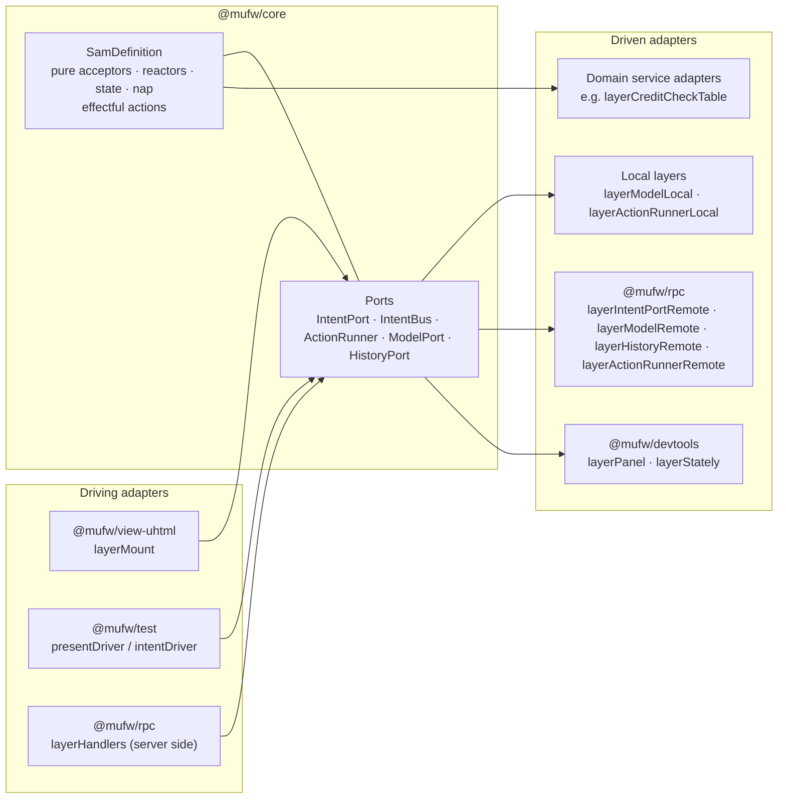
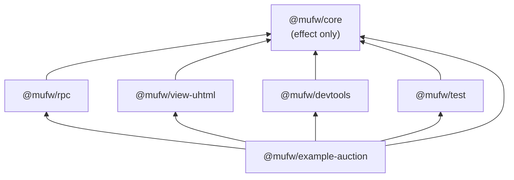

# Architecture

Living document: change it in the same commit that changes what it describes. Detailed pages:

- [architecture/sam-loop.md](architecture/sam-loop.md) — definition, step, automatic actions, history and travel
- [architecture/placement.md](architecture/placement.md) — ports, layers, the RPC contract, the four placements
- [architecture/testing.md](architecture/testing.md) — graph exploration and model-based path testing
- [architecture/devtools.md](architecture/devtools.md) — time-travel panel and Stately adapter

## Shape of the system

µFW is a hexagon around one SAM definition.

| Hexagonal term | µFW |
|---|---|
| Domain | The `SamDefinition`: schemas plus pure acceptors, reactors, `state`, `nap` |
| Application services | The definition's `actions`: the only effectful part, they turn intents into proposals |
| Driving ports | `IntentPort.dispatch`, `ModelPort.present` |
| Driven ports | `ActionRunner`, `ModelPort`, `HistoryPort`, and domain services the actions require (`CreditCheck`, `CurrentBidder`) |
| Driving adapters | the uhtml view, test drivers, RPC handlers on the server, the authentication middleware in front of them |
| Driven adapters | local layers, remote RPC layers, `layerCreditCheckTable`/`layerCreditCheckPermissive`, `layerSessionsTable`, `layerCurrentBidderFixed`, devtools |
| Composition roots | one per deployment: `examples/auction/src/client/<page>.ts`, `server.ts`, `test/live.ts` |

Ports are Effect service keys (`Context.Service`) created per definition by `makePorts(def)`;
adapters are `Layer`s. Choosing a placement is choosing layers in a deployment's composition root;
only the demo page chooses at runtime.

## Packages and dependency direction

- `@mufw/core` depends on `effect` alone and contains no platform, DOM or transport code.
- `@mufw/rpc` defines the wire contract and remote adapters but no transport; the application
  picks the protocol (websocket, HTTP, worker) and the serialization.
- Adapter packages never depend on each other.
- Platform packages (`@effect/platform-node`, `@effect/platform-browser`) appear only in the example.

Packages are consumed as TypeScript sources (`exports: { ".": "./src/index.ts" }`); vite, vitest and
tsx compile them on the fly. There is no build step.

## Where effects are run

Code stays inside `Effect`/`Stream`/`Layer` across every package. Effects are run only here:

| Boundary | Where | How |
|---|---|---|
| Browser page | `examples/auction/src/client/app.ts` (`runPage`, called by each page's entry point) | `BrowserRuntime.runMain(Layer.launch(page))` |
| Node server | `examples/auction/src/server.ts` | `Layer.launch(...).pipe(NodeRuntime.runMain)` |
| Live path test | `examples/auction/test/live.ts` | `NodeRuntime.runMain(program)` |
| DOM events | `layerMount` dispatch, `layerPanel` row click | `FiberSet.makeRuntime` captured in the layer: the fiber inherits the layer's services and references and is interrupted with its scope |
| Tests | every `*.test.ts` | `@effect/vitest` `it.effect` |

## Data at the edges

Every cut point of the loop is a `Schema`: model, proposal, intent, representation and the history
record (`stepRecordSchema`). RPC decodes and encodes with them, so a value that crosses the wire
arrives as a domain type or not at all. Business rejections are proposals (`BidRejected`), not
errors; technical failures are typed errors (`ActionFailure`, `NoSuchStep`); a call that finds the
transport lost is a defect, while the remote streams resubscribe (see
[placement](architecture/placement.md)). Gaps in parsing at the example's own boundaries are tracked in [TODO.md](TODO.md).

## Decisions

Each entry states the choice and the constraint behind it.

- **`define(schemas)(behaviour)` is curried.** TypeScript only types the behaviour's literals
  (`_tag`, control states) from the schemas once the schemas are fixed by a first call; a single
  call widens them to `string`.
- **Ports are function-style service keys with per-definition identifiers** (`IntentBus<D>` …),
  so their types can be named and the same framework can host several definitions.
- **Placement is per deployment, not per request.** Each page has its own entry point that calls
  one placement module; the server's served RPCs come from `Config`. A placement chosen by the
  visitor would let the visitor choose what the server trusts.
- **A server that owns the actions receives intents (`Submit`), not proposals.** Serving `Present`
  to an untrusted client lets it apply any proposal and bypass every rule enforced by the actions.
- **`Dispatch` returns the proposal and the caller presents it.** It serves a client-side model with
  server-side actions; actions never need to know where the model is.
- **`IntentPort` is separate from `IntentBus`.** The view only submits intents; with the actions on
  the server there is no local queue to put them in. Its `dispatch` fails with `DispatchRefused`
  when the server refuses the caller; only a lost transport is a defect, in `@mufw/rpc`.
- **Domain services are ports; their implementations are adapters in separate modules**
  (`CreditCheck` vs `layerCreditCheckTable`), so a browser bundle never contains server secrets.
- **Identity is a port, not part of the intent.** `PlaceBid` carries an amount; the action reads
  `CurrentBidder`. A server provides it per request from a session token (RPC middleware on
  `Submit` and `Dispatch`), so a client cannot name the bidder; a page that runs its own actions
  provides it at its composition root, because there the browser is trusted with the model anyway.
- **The dispatcher's services travel with the intent, and are typed.** The bus queue would drop a
  request's context; `IntentEnvelope.context` carries it to the action, generically, so core knows
  nothing of authentication. `Ports<D, R>` puts the per-request services `R` in the `R` of the
  effects that carry an intent, so a dispatcher without them does not compile, and
  `layerLoopLocal` does not require them when built. Services captured when a layer is built win
  over the caller's, and automatic intents carry none.
- **A refused dispatch reaches the page as data, apart from the representation.** `layerMount`
  hands a `DispatchRefused` to its `onRefused` effect; the example reports it into a `Refusals`
  service that a notice layer renders, so the domain and the SAM representation stay unaware.
- **The session token is a request header, not a connection property.** A browser websocket cannot
  set headers, but an RPC request can, so the client middleware adds the token to each request and
  one connection could serve several identities.
- **The RPC client is a service (`Client<D>`) shared by the remote ports**, provided either
  over a transport (`layerClient`) or in-process (`layerClientTest`, backed by `RpcTest`).
- **The RPC group is typed by hand (`SamRpcs<D>`).** Inferring it through a generic `D` widens the
  schemas to `any`, which leaks `any` into the services every server layer requires.
- **An automatic action's tag is released when the action has its proposal, before presenting.**
  The `nap` of that very step must be able to start the next round, or a tick loop can stop.
- **A travel interrupts automatic actions in flight, in the bus the model emitted them on.**
  Tagging proposals with a seq would change the `Present` payload, and a remote model could not
  tell a stale proposal from a concurrent one; `nap` always runs next to the bus, so the model
  can cancel the fibers itself under its permit.
- **History is bounded by count (`HistoryLimit`, default 1000) and always keeps seq 0.** Seqs are
  never reused, and an evicted seq is a `NoSuchStep` like an unknown one.
- **Graph nodes are keys (default: control state); exploration states are a finer `serialize`.**
  Some states share a node but enable different transitions (an auction closing before and after
  its deadline); exploring only the first model of each node would miss them.
- **`toXStateDefinition` lists every distinct target of a tag.** One tag can lead to different
  nodes depending on the model; keeping only the first edge hid `closing → sold` in Stately.
- **uhtml is imported lazily by the view and panel layers.** Its entry module needs a DOM at import
  time, so a top-level import would break every Node consumer of those packages.
