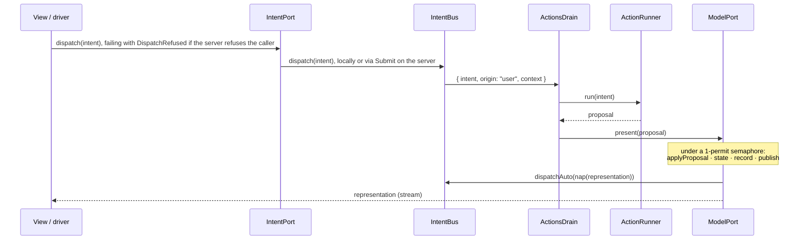

# The SAM loop

Living document. Source of truth: `packages/core/src/Definition.ts`, `Step.ts`, `Layers.ts`.

## Definition

```ts
define({ name, model, proposal, intent, representation })({
  controlStates, initial, acceptors, reactors, state, nap, actions
})
```

| Field | Kind | Contract |
|---|---|---|
| `model`, `proposal`, `intent`, `representation` | `Schema` without decoding/encoding services | every cut point is serializable and recordable |
| `representation["Type"]` | must contain `controlState: string` | SAM's control state; also the Stately `value` |
| `controlStates` | `ReadonlyArray<string>` | the states the test model must reach |
| `initial` | model value | seq 0 of the history |
| `acceptors` | `(model, proposal) => model`, pure | folded in declared order; each handles its tags and returns the model unchanged otherwise |
| `reactors` | `(model) => model`, pure | folded after the acceptors |
| `state` | `(model) => representation`, pure | derives the control state |
| `nap` | `(representation) => Option<intent>`, pure | the next automatic action |
| `actions` | `{ [intentTag]: (intent) => Effect<proposal, ActionFailure, R> }` | the only effectful part; `R` is the services they need |

`applyProposal(def, model, proposal)` is the whole pure step: acceptors, then reactors.

## One step



`layerModelLocal` holds the only mutable state of the framework: the model, the representation (a
`SubscriptionRef`), the record array and a `PubSub` of records. Every mutation runs under one
permit, so steps and travels are serialized and replay is sound.

## Automatic actions

- An intent from `nap` has origin `auto`; one from a user or driver has origin `user`.
- `ActionsDrain` skips an `auto` intent whose tag has an action still running. User intents are
  never deduplicated.
- The tag is released as soon as the action has its proposal, before presenting it, so the `nap`
  of that step can start the next round.
- A user intent's envelope carries the services of the fiber that dispatched it (`context`), and the
  drain runs its action with them: this is how a server's per-request identity reaches an action
  through the queue. Those services are the ports' `R`: it is in the `R` of `IntentBus.dispatch`,
  `IntentPort.dispatch` and `ActionRunner.run`, so a dispatcher that does not provide them does not
  compile. An automatic intent carries an empty context, so an automatic action never acts as
  whoever presented the last proposal, and one that needs a per-request service dies.
- `AutoActions` (`Context.Reference<boolean>`, default `true`) set to `false` drops every `auto`
  intent. Path tests and a server under test use it so ticks cannot move the model between steps.

### Travel and actions in flight

**Rule: `travelTo` interrupts every automatic action in flight; none of them presents afterwards.**
An automatic action is computed from a state the travel has just left, so its proposal is stale by
construction (a pending `Tick` would move `now` back to wall time). The model does this itself,
under its permit, before it appends the `travel` record: the bus owns the fibers of automatic
actions (`IntentBus.runAuto`) and the model calls `IntentBus.interruptAuto`. A `travelTo` that
fails with `NoSuchStep` interrupts nothing.

- The tag of an interrupted action is released, so the first step after the travel can start the
  next automatic round. The travel itself does not run `nap`.
- The rule needs no proposal tagging and no extra RPC payload: an automatic intent is always
  emitted by a local model's `nap` onto the bus next to it, so the fibers and the model that
  interrupts them live in the same process in every placement.
- A state that only `nap` can leave is a dead end after a travel and with `AutoActions` false, so the
  view of every such state offers the same intent as a user control. The auction's `opening`
  disables the bid form and shows **Open auction**, which dispatches `Open`; user intents run
  whatever `AutoActions` says and are not interrupted by a travel.

| Placement | Where `nap`, the bus and the model live | What the travel interrupts |
|---|---|---|
| browser only | browser | the local action fiber |
| server actions (local model, remote actions) | browser | the fiber awaiting `Dispatch`; interrupting it cancels the RPC call |
| server model (remote model, local actions) | server (its own loop) | the server's action fibers; the browser's drain only runs user intents |
| server owned | server | the server's action fibers |

- User actions are explicit commands, not derived from the state that was left: a user action
  running during a travel still presents its proposal.

## Failures

| Situation | Representation | Where it goes |
|---|---|---|
| Business rejection | a proposal (`BidRejected`) | accepted into the model like any other |
| `ActionFailure` | typed error of the action | logged with `Effect.logWarning`; model untouched |
| Defect in an action or in `present` | `Cause` | logged with `Effect.logError("action died", intentTag, cause)`; the fiber ends, the drain keeps consuming intents |
| Unknown or evicted step in `travelTo` | `NoSuchStep` | returned to the caller |
| RPC call on a lost transport | defect | not a domain outcome; inside an action or `present` the drain logs it as above. Remote streams resubscribe instead |

Interruption (a travel, or the scope closing) is not a defect and is not logged.

## History and time travel

- Records: `{ seq, at, kind: "init" | "step" | "travel", proposal: Option, model, representation, travelledTo? }`.
- `travelledTo` is the seq whose model and representation a `travel` record restored (an
  `Schema.optional(Schema.Int)`); it is absent on `init` and `step` records, and the `History` RPC
  carries it because it is part of `stepRecordSchema`.
- `records` streams every retained record, then live ones, without gaps or duplicates (subscribe
  first, snapshot second, filter by `seq`).
- `travelTo(seq)` sets model and representation from that record, appends a `travel` record with
  `travelledTo: seq`, interrupts automatic actions in flight (above) and does **not** run `nap`;
  automatic loops resume with the next step.

### Retention

- `layerModelLocal` keeps the initial record (seq 0) and the newest records up to `HistoryLimit`
  (`Context.Reference<number>`, default 1000), the initial record included in the count. When a
  commit exceeds the limit the oldest records after seq 0 are evicted. A limit below 2 keeps the
  initial record and the newest one.
- Seqs are never reused: the retained records are seq 0 followed by a consecutive window starting at
  the oldest kept seq. `records` replays them, not the evicted gap.
- `travelTo` an evicted seq fails with `NoSuchStep`, like a seq that never existed. Seq 0 is never
  evicted, so a consumer that resets with `travelTo(0)` (the path runner of `@mufw/test`, a replay
  against a long-lived server) always can.
