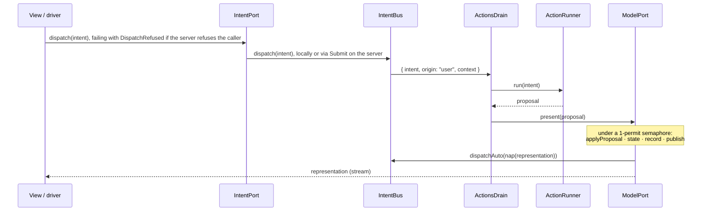
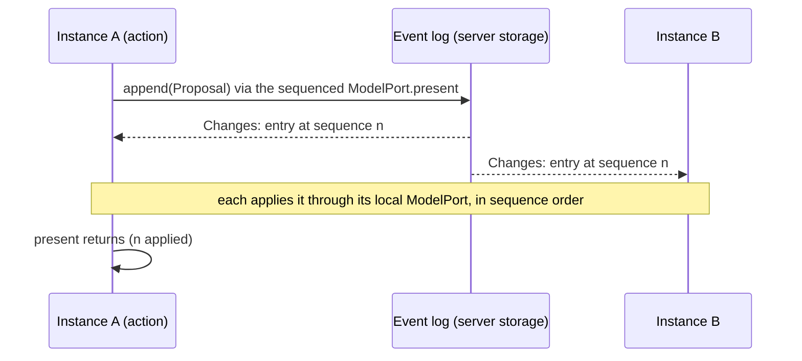

# The SAM loop

Living document. Source of truth: `packages/core/src/Definition.ts`, `Step.ts`, `History.ts`, `Layers.ts`, `Persistence.ts`, `Sync.ts`, `Nest.ts`.

## Definition

```ts
define({ name, model, proposal, intent, representation })({
  controlStates, initial, acceptors, reactors, state, nap, actions
})
```

| Field | Kind | Contract |
|---|---|---|
| `model`, `proposal`, `intent`, `representation` | `Schema` without decoding/encoding services | every cut point is serializable and recordable |
| `representation["Type"]` | must contain `controlState: string` | SAM's control state; also the Stately `value` |
| `controlStates` | `ReadonlyArray<string>` | the states the test model must reach |
| `initial` | model value | seq 0 of the history |
| `acceptors` | `(model, proposal) => model`, pure | folded in declared order; each handles its tags and returns the model unchanged otherwise |
| `reactors` | `(model) => model`, pure | folded after the acceptors |
| `state` | `(model) => representation`, pure | derives the control state |
| `nap` | `(representation) => Option<intent>`, pure | the next automatic action |
| `intentKey` | `(intent) => string`, pure, optional (default `intent._tag`) | automatic intents with the same key are not run concurrently: the drain skips one while another of its key is in flight |
| `actions` | `{ [intentTag]: (intent) => Effect<proposal, ActionFailure, R> }` | the only effectful part; `R` is the services they need |

`applyProposal(def, model, proposal)` is the whole pure step: acceptors, then reactors.

## One step



`layerModelLocal` holds the only mutable state of the framework: the model, the representation (a
`SubscriptionRef`), the record array and a `PubSub` of records. Every mutation runs under one
permit, so steps and travels are serialized and replay is sound.

`layerModelLocal(def, ports, options?)` and `layerLoopLocal` take `options.initial`, an
already-decoded `ModelOf<D>`: seq 0 (`init`) and the first representation come from it instead of
`def.initial`, and `travelTo(0)` returns to it. Decoding untrusted input (a snapshot embedded in a
page) into that model is the caller's job, at its composition root.

## Automatic actions

- An intent from `nap` has origin `auto`; one from a user or driver has origin `user`.
- `ActionsDrain` skips an `auto` intent whose key (`intentKey`, default its tag) has an action still
  running. User intents are never deduplicated.
- The key is released as soon as the action has its proposal, before presenting it, so the `nap`
  of that step can start the next round.
- A user intent's envelope carries the services of the fiber that dispatched it (`context`), and the
  drain runs its action with them: this is how a server's per-request identity reaches an action
  through the queue. Those services are the ports' `R`: it is in the `R` of `IntentBus.dispatch`,
  `IntentPort.dispatch` and `ActionRunner.run`, so a dispatcher that does not provide them does not
  compile. An automatic intent carries an empty context, so an automatic action never acts as
  whoever presented the last proposal, and one that needs a per-request service dies.
- `AutoActions` (`Context.Reference<boolean>`, default `true`) set to `false` drops every `auto`
  intent. Path tests and a server under test use it so ticks cannot move the model between steps.

### Travel and actions in flight

**Rule: `travelTo` interrupts every automatic action in flight; none of them presents afterwards.**
An automatic action is computed from a state the travel has just left, so its proposal is stale by
construction (a pending `Tick` would move `now` back to wall time). The model does this itself,
under its permit, before it appends the `travel` record: the bus owns the fibers of automatic
actions (`IntentBus.runAuto`) and the model calls `IntentBus.interruptAuto`. A `travelTo` that
fails with `NoSuchStep` interrupts nothing.

- The key of an interrupted action is released, so the first step after the travel can start the
  next automatic round. The travel itself does not run `nap`.
- The rule needs no proposal tagging and no extra RPC payload: an automatic intent is always
  emitted by a local model's `nap` onto the bus next to it, so the fibers and the model that
  interrupts them live in the same process in every placement.
- A state that only `nap` can leave is a dead end after a travel and with `AutoActions` false, so the
  view of every such state offers the same intent as a user control. The auction's `opening`
  disables the bid form and shows **Open auction**, which dispatches `Open`; user intents run
  whatever `AutoActions` says and are not interrupted by a travel.

| Placement | Where `nap`, the bus and the model live | What the travel interrupts |
|---|---|---|
| browser only | browser | the local action fiber |
| server actions (local model, remote actions) | browser | the fiber awaiting `Dispatch`; interrupting it cancels the RPC call |
| server model (remote model, local actions) | server (its own loop) | the server's action fibers; the browser's drain only runs user intents |
| server owned | server | the server's action fibers |
| worker | the worker (its own loop, reached through `TravelTo`) | the worker's action fibers |

- User actions are explicit commands, not derived from the state that was left: a user action
  running during a travel still presents its proposal.

## Failures

| Situation | Representation | Where it goes |
|---|---|---|
| Business rejection | a proposal (`BidRejected`) | accepted into the model like any other |
| `ActionFailure` | typed error of the action | logged with `Effect.logWarning`; model untouched |
| Defect in an action or in `present` | `Cause` | logged with `Effect.logError("action died", intentTag, cause)`; the fiber ends, the drain keeps consuming intents |
| Unknown or evicted step in `travelTo` | `NoSuchStep` | returned to the caller |
| RPC call written to a transport that is then lost | defect | not a domain outcome; inside an action or `present` the drain logs it as above. A call made while the transport is down is held and sent after the reconnection; remote streams resubscribe |

Interruption (a travel, or the scope closing) is not a defect and is not logged.

## History and time travel

- Records: `{ seq, at, kind: "init" | "step" | "travel", proposal: Option, model, representation, travelledTo? }`.
- `travelledTo` is the seq whose model and representation a `travel` record restored (an
  `Schema.optional(Schema.Int)`); it is absent on `init` and `step` records, and the `History` RPC
  carries it because it is part of `stepRecordSchema`.
- `records` streams every retained record, then live ones, without gaps or duplicates (subscribe
  first, snapshot second, filter by `seq`).
- `travelTo(seq)` sets model and representation from that record, appends a `travel` record with
  `travelledTo: seq`, interrupts automatic actions in flight (above) and does **not** run `nap`;
  automatic loops resume with the next step.

### Retention

- `layerModelLocal` keeps the initial record (seq 0) and the newest records up to `HistoryLimit`
  (`Context.Reference<number>`, default 1000), the initial record included in the count. When a
  commit exceeds the limit the oldest records after seq 0 are evicted. A limit below 2 keeps the
  initial record and the newest one.
- Seqs are never reused: the retained records are seq 0 followed by a consecutive window starting at
  the oldest kept seq. `records` replays them, not the evicted gap.
- `travelTo` an evicted seq fails with `NoSuchStep`, like a seq that never existed. Seq 0 is never
  evicted, so a consumer that resets with `travelTo(0)` (the path runner of `@mufw/test`, a replay
  against a long-lived server) always can.

### Export, import and replay

`History.ts` works on a history held as `ReadonlyArray<StepRecord>` (the `records` stream collected).

| Function | Contract |
|---|---|
| `historySchema(def)` | `Schema.Array(stepRecordSchema(def))` |
| `encodeHistoryJson(def)(records)` | `Effect<string, SchemaError>`: the JSON text of the history (`Option` as `{"_tag":"None"}` / `{"_tag":"Some","value":…}`) |
| `decodeHistoryJson(def)(json)` | `Effect<ReadonlyArray<StepRecord>, SchemaError>`: the only place untrusted history text is parsed; malformed JSON or a record that does not match the definition's schemas fails with a `SchemaError` |
| `replayFrom(def, records, seq)` | pure, `Result<ReadonlyArray<StepRecord>, NoSuchStep>`: starts from the model of record `seq`, re-applies the proposal of every later `step` record with `applyProposal`, and returns the recomputed records (recorded `seq`, `at` and proposal; recomputed model and representation). `NoSuchStep` when `records` has no record `seq` |
| `replayInto(ports, records, seq)` | `Effect<void, NoSuchStep \| ReplayBaseMismatch, ModelPort \| HistoryPort>`: `HistoryPort.travelTo(seq)`, a check that the live representation equals the one recorded at `seq` (`Equal.equals`), then `ModelPort.present` for each later recorded proposal, in order; nothing else of the loop is touched |

- Only `step` records are replayed; a `travel` record after `seq` is skipped. The loop appends a
  `travel` record and one `step` per proposal under its own next seqs, so a recorded
  `travelledTo` cannot be honoured.
- `replayInto` fails with `NoSuchStep` before touching the ports when `records` has no record `seq`,
  and with the port's `NoSuchStep` when the loop no longer retains it (seq 0 is always retained).
- `travelTo(seq)` restores what the live loop recorded under `seq`, not what `records` recorded: an
  imported history, or a loop that has moved on, can hold another model there. `replayInto` then
  fails with `ReplayBaseMismatch { seq }` and presents nothing, leaving the loop at the state the
  travel restored. The check compares representations, since the ports expose no model; a model
  difference the representation does not show is not detected.
- Every `present` runs the loop's `nap`, and the recorded history already contains the automatic
  proposals it produced. `replayInto` reproduces the recording only on a loop whose automatic
  actions are off (`AutoActions` false); with them on, `nap` starts them again and they apply a
  second time. `replayFrom` is unaffected: it never runs `nap`.

## Persistence

`Persistence.ts` keeps the **model** (not the history) in an `effect/persistence` `KeyValueStore`.
The store is a port: core only requires the `KeyValueStore` service, and the composition root picks
memory, a directory of files or any other implementation.

| Function | Contract |
|---|---|
| `loadModel(def, key?)` | `Effect<Option<ModelOf<D>>, KeyValueStoreError \| SchemaError, KeyValueStore>`: the JSON text under `key` (default `def.name`) decoded with `def.model`; `none` when the key is absent |
| `layerPersistModel(def, ports, key?)` | background fiber over `HistoryPort.records`: writes `record.model` under `key` for the newest `step` or `travel` record, coalescing the records that commit while a write is in flight. Requires `KeyValueStore`, `HistoryPort` |
| `layerLoopPersisted(def, ports, key?)` | `loadModel`, then `layerLoopLocal(def, ports, { initial })` (`def.initial` when `none`) with `layerPersistModel` on top; provides what `layerLoopLocal` provides, fails like `loadModel` |

- **Parse, don't validate.** Stored text is untrusted: it is decoded once, at load, with the
  model's schema (`Option`s take their canonical JSON form, as in history export). A value that does
  not decode fails the layer with a `SchemaError`, so the loop never starts, and the value is left in
  the store. Falling back to `def.initial` would hide the data loss and the next step would overwrite it.
- **Composition, not a change to the model layer.** `layerModelLocal` still knows nothing about
  storage; the writer reads the same `records` stream as devtools and `@mufw/rpc`. The `init`
  record is not written (it is the model just loaded, or `def.initial`), so a loop that never steps
  leaves the store as it was; `travelTo(0)` writes the restored model like any travel.
- **Writes are off the permit.** A step commits, releases the permit and only then reaches the
  writer through the records `PubSub`; a slow store never slows `present`. Writes run in commit
  order on one fiber.
- **Only the newest model is written.** The writer's input is a sliding buffer of capacity 1 after
  the `init` filter, so it keeps draining the `PubSub` subscription however slow the store is: at
  most the write in flight and one pending record (the newest) exist, and the models of the steps in
  between are never written. With a slow store and a burst of steps the store receives the first
  model and the last one.
- **Durability: last write wins, no flush.** The store holds the model of a recent record. Each write
  is uninterruptible, so closing the layer's scope waits for the write in flight rather than abandoning
  it half done (an interrupted `KeyValueStore.layerFileSystem` write leaves an empty file); the pending
  record is dropped at close. A crash loses the write in flight and the pending record, nothing
  older. Whether a crash mid-write can tear the stored value is up to the store: the example's
  `layerAtomicFileStore` (`examples/auction/src/persistence.ts`) writes `<file>.tmp` and renames it
  onto the key's file, so a process crash leaves the previous model or the new one (no `fsync`: a
  power loss is not covered). Two instances on one store overwrite each other; to run several
  instances see [Synchronisation across instances](#synchronisation-across-instances), which does not
  combine with this layer.
- **A failed write is logged, not fatal.** A `KeyValueStoreError` (or a defect) is logged at error
  level with the record's seq and the writer carries on: the in-memory loop is the source of truth
  while it runs, and the next record's model supersedes the one that was lost. Failing the loop
  would turn a full disk into a stopped auction.
- **What is stored.** Only the model. The history (retention window, seqs, proposals) starts again
  from seq 0 after a restart, with the loaded model as the initial record; `travelTo(0)` returns to it.

## Synchronisation across instances

`Sync.ts` runs one definition on several servers that converge on one model. The mechanism is
`effect/eventlog`; core only requires the services, and the application picks the transport.

**The log is the sequencer.** Acceptors are pure but not commutative (a bid is accepted or rejected
against the highest bid so far), so the instances must apply the same proposals in the same order.
`effect/eventlog` alone does not give that: `EventLog.write` runs the handler of the writer's own entry
at once and a remote entry's handler later, with the entries that sort after it by the writer's clock
id passed as `conflicts`, and the clients' journals sort by those ids. So the loop does not use the
`EventLog` runtime: it uses the one thing the event-log server fixes for everyone, the order in which
writes reach its `Storage` (`remoteSequence`, assigned inside one transaction). Every client reads
`Changes` in that order, its own entries included.

| Part | Contract |
|---|---|
| `SyncLog` | `Context.Service`: `append(entry)` and `entries(from)`, the entries with `remoteSequence >= from` in sequence order, then live ones, every client's own included |
| `layerLoopSynced(def, ports)` | `layerLoopLocal` over a `SyncLog`. Requires `SyncLog` and the actions' services; provides the five ports |
| `layerSyncServer(def)` | the `EventLogRemoteRpcs` handlers over an in-memory `Storage` (also provided), one store per definition (`syncStoreId`). Requires `EventLogServerAuthorization` and a `Registry` it builds itself. Only `Proposal` entries (decoded with the definition's `proposal` schema; one that does not decode is refused) and `Joined` entries have a handler. An entry with another tag is stored undecoded unless the authorization refuses it |
| `layerSyncAuthorization` | `EventLogServerAuthorization`: any identity may read; a write is refused (`Unauthorized` to the client) unless every entry is a `Proposal` or a `Joined`. It does not say who may write: the endpoint is for trusted instances only |
| `layerSyncLogStorage(def)` | a `SyncLog` over the server's own `Storage`: the host process appends and reads in-process, in the same transaction and sequence as the RPC writers |
| `layerSyncLogClient(def)`, `layerSyncLogRemote(def)` | a `SyncLog` over `EventLogRemote.makeUnencrypted` and a generated identity; the first needs `EventLogRemoteClient`, the second the client `RpcClient.Protocol` (websocket, `RpcSerialization.layerSchemaBinary`: entries are binary) |



- **Two model ports.** The layer builds a local model under keys derived from the definition's name
  (`<name>/replica`) and exposes under the definition's own keys a `ModelPort` whose `present` appends
  and awaits, and whose `representations` are the replica's. The drain, the `Present` RPC and every
  other caller see only the sequenced port, so model mutation stays in `layerModelLocal` under its
  permit and an instance cannot apply what it produced before the log has ordered it. The applier
  alone calls the replica's `present`.
- **No echo.** The applier presents to the replica, never to the exposed port, so an entry read from
  the log is not written back; each proposal is applied exactly once per instance.
- **`present` returns once the instance has applied the proposal**, not once the log accepted it: the
  caller then reads its own write.
- **A lost connection is not a failure of `present`.** A failure of the append that is not an answer
  of the server (the socket dropped with the write in flight, so it is not known whether the log
  stored it) is retried with the same entry, same id, every second: the event-log server drops an
  entry whose id it holds, so the retry cannot store it twice. `present` also returns as soon as the
  entry comes back through `entries`, even if its append was never confirmed. Only the server's own
  answer, an authorization refusal or a payload that does not decode, is a defect. While the log is
  out of reach `present` waits, and so does building the layer: the example's transport holds a
  request made while the socket is down until the next connection (`layerHoldRequestsWhileDisconnected`),
  so an instance started while the host is unreachable has its port open but answers nothing, every
  request hanging, until it has reached the log and replayed it.
- **What is guaranteed.** Instances that start from `def.initial`, read the log from its first entry
  and apply nothing else end with equal models after the same entries, whatever clocks they have:
  the order is the server's arrival order, not the entries' ids. `core/test/Sync.test.ts` shows it for
  two proposals formed on different instances and logged in the opposite order.
- **Actions stay local.** An intent runs its action (credit check, identity, clock) on the instance
  that received it; only the proposal travels, with everything the acceptors need (`at`, `now`). An
  acceptor that reads anything else is not deterministic across instances.
- **Catch-up: replay from the first entry; no snapshot.** The layer starts the applier at sequence 0
  and appends a `Joined` entry; it is built once that entry has been applied, and entries are applied
  in order, so everything the log held when the instance joined is in its model before it serves. The
  cost is the log's length. A `Joined` entry changes no model; it is the marker of that moment.
- **Resubscription.** When the stream of entries fails (a lost connection) it is subscribed again after
  a second from the next unapplied sequence, so no entry is applied twice or skipped.
- **A proposal that does not decode, or whose acceptor dies,** is logged and skipped; all instances
  skip it alike. Instances of different versions of the definition can disagree.
- **`nap` runs on every instance, so exactly one runs automatic actions.** Each instance derives the
  same next intent from the same model; with `AutoActions` true everywhere the auction would receive a
  tick per instance and second. This is a deployment rule, not enforced: `AutoActions` true on one
  instance, false on the others (the example's `MUFW_AUTO_ACTIONS`, defaulting to `off` for an
  instance that joins). No ticker takes over when that instance stops.
- **What breaks convergence.** `HistoryPort.travelTo` moves one instance's model away from the log
  (the example's server refuses `TravelTo` with `MUFW_SYNC`); a model restored from elsewhere
  (`options.initial`, `layerLoopPersisted`) is not the log's, so the loop takes no `initial`.
  Instances applying the same log hold the same `seq`, `model` and `proposal` for each record; only
  `at`, the instance's own commit time, differs.
- **The log is volatile and only for trusted instances.** The server's `Storage` is in memory: a host
  that restarts starts an empty log, which an instance that still holds the old one does not detect
  (it would wait for sequences the new log has not reached), so restart them together. Whoever can
  write to the event-log endpoint can append any proposal that decodes, and every instance applies it:
  it bypasses the sessions and the credit check of the RPC that would have produced the proposal, the
  way `Present` does on one server. The write is open to every identity because the server's
  authorization interface sees only a generated public key, never the connection, so a shared secret
  has nowhere to be checked. `layerSyncAuthorization` still refuses entries of events the log does not
  hold, and the example serves the endpoint on a listener of its own (`MUFW_SYNC_PORT`) on a router
  of its own, bound to `127.0.0.1` unless `MUFW_SYNC_HOST` says otherwise, never on the public port.

## Nested definitions

`nest(parent, child, options?)` (`Nest.ts`) is a pure function from two definitions to one, for
wizards and forms: the result is an ordinary `SamDefinition`, so one loop, one history and one
graph cover both sides, and every placement and tool takes it unchanged.

| Part of the result | Contract |
|---|---|
| `name` | `options.name`, default `${parent.name}/${child.name}` (ports are keyed by name) |
| `model` | `{ parent, child }`; `initial` combines both sides' |
| `proposal`, `intent` | the parent's union, unwrapped, plus `{ _tag: "Child", proposal }` / `{ _tag: "Child", intent }` carrying the child's. A parent that already has a `Child` proposal or intent tag is an authoring bug: `nest` throws |
| `representation` | `{ controlState, parent, child }`; `controlState` is `options.controlState(parent, child)`, default the parent's |
| `controlStates` | `options.controlStates`, which must list every value `controlState` can take (required with `options.controlState`, enforced by its type); default the parent's. The representation schema decodes only these |
| `acceptors`, `reactors` | each side's own, routed by wrapper: a parent acceptor sees only `model.parent` and the unwrapped parent proposals, a child acceptor only `model.child` and the payload of `Child` proposals. Reactors run per side after all acceptors |
| `nap` | the parent's intent if `Some`, else the child's wrapped in `Child` |
| `intentKey` | a child intent is keyed `Child/` plus the child's own key, so two different automatic child intents run concurrently and a repeated one is still skipped; a parent intent keeps the parent's key |
| `actions` | the parent's, plus `Child`, which runs the child's action for the wrapped intent and wraps the proposal it returns |
| services | `ServicesOf<parent> \| ServicesOf<child>` |

Forwarding makes the sides react to each other without a second step. `options.toChild(proposal)`
receives every accepted parent proposal and `options.toParent(proposal)` every accepted child
proposal (unwrapped); a `Some` is applied to the other side's acceptors inside the same
`applyProposal`, so the history gets one record and `Present` carries one proposal.

- Forwarding is one hop. The forwarded proposal goes through the other side's acceptors only; it
  is neither forwarded back nor offered to `toParent`/`toChild` again, so two sides forwarding to
  each other cannot loop.
- Forwarding acceptors run after the routed ones, and the reactors after all of them: a forwarded
  proposal lands on a side that already took its own, and each side's reactors see the final model.
- `toChild`/`toParent` see the proposal, not the model.
- The drain skips an automatic intent whose `intentKey` is already in flight. A child intent's key
  carries the child's own key (`Child/ClearA`), so `nap`'s next child intent of another kind is not
  held back by a slow child action; a child intent of the same kind is skipped, as in a flat definition.

A nested definition can be the child of another `nest`; as a parent it already has the `Child` tag,
so `nest` throws. Its graph is explored like any other: with a combined `controlState`
(`"low/high"`) the nodes are the combinations of both sides' states.
