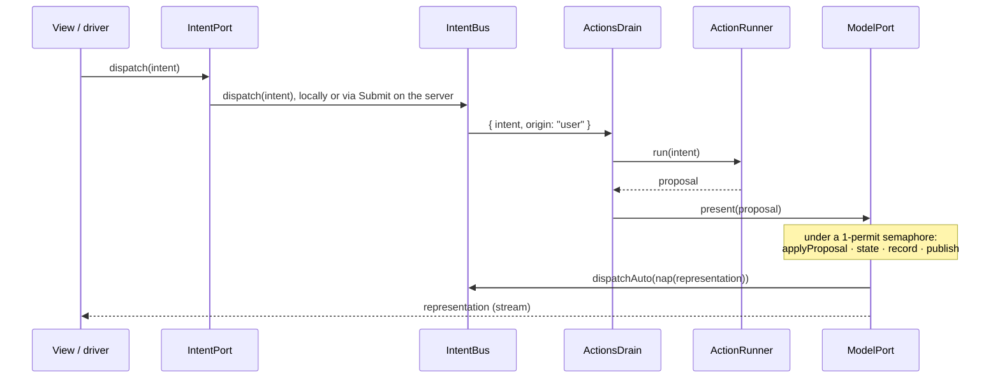

# The SAM loop

Living document. Source of truth: `packages/core/src/Definition.ts`, `Step.ts`, `Layers.ts`.

## Definition

```ts
define({ name, model, proposal, intent, representation })({
  controlStates, initial, acceptors, reactors, state, nap, actions
})
```

| Field | Kind | Contract |
|---|---|---|
| `model`, `proposal`, `intent`, `representation` | `Schema` without decoding/encoding services | every cut point is serializable and recordable |
| `representation["Type"]` | must contain `controlState: string` | SAM's control state; also the Stately `value` |
| `controlStates` | `ReadonlyArray<string>` | the states the test model must reach |
| `initial` | model value | seq 0 of the history |
| `acceptors` | `(model, proposal) => model`, pure | folded in declared order; each handles its tags and returns the model unchanged otherwise |
| `reactors` | `(model) => model`, pure | folded after the acceptors |
| `state` | `(model) => representation`, pure | derives the control state |
| `nap` | `(representation) => Option<intent>`, pure | the next automatic action |
| `actions` | `{ [intentTag]: (intent) => Effect<proposal, ActionFailure, R> }` | the only effectful part; `R` is the services they need |

`applyProposal(def, model, proposal)` is the whole pure step: acceptors, then reactors.

## One step



`layerModelLocal` holds the only mutable state of the framework: the model, the representation (a
`SubscriptionRef`), the record array and a `PubSub` of records. Every mutation runs under one
permit, so steps and travels are serialized and replay is sound.

## Automatic actions

- An intent from `nap` has origin `auto`; one from a user or driver has origin `user`.
- `ActionsDrain` skips an `auto` intent whose tag has an action still running. User intents are
  never deduplicated.
- The tag is released as soon as the action has its proposal, before presenting it, so the `nap`
  of that step can start the next round.
- `AutoActions` (`Context.Reference<boolean>`, default `true`) set to `false` drops every `auto`
  intent. Path tests and a server under test use it so ticks cannot move the model between steps.

## Failures

| Situation | Representation | Where it goes |
|---|---|---|
| Business rejection | a proposal (`BidRejected`) | accepted into the model like any other |
| `ActionFailure` | typed error of the action | logged with `Effect.logWarning`; model untouched |
| Unknown step in `travelTo` | `NoSuchStep` | returned to the caller |
| Lost RPC transport | defect | not a domain outcome; dies |

## History and time travel

- Records: `{ seq, at, kind: "init" | "step" | "travel", proposal: Option, model, representation }`.
- `records` streams every existing record, then live ones, without gaps or duplicates (subscribe
  first, snapshot second, filter by `seq`).
- `travelTo(seq)` sets model and representation from that record, appends a `travel` record and
  does **not** run `nap`; automatic loops resume with the next step. An automatic action already
  in flight still presents its proposal after the travel.
- History is in memory and unbounded.
