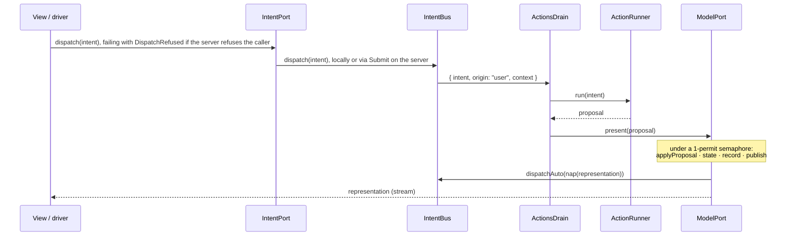
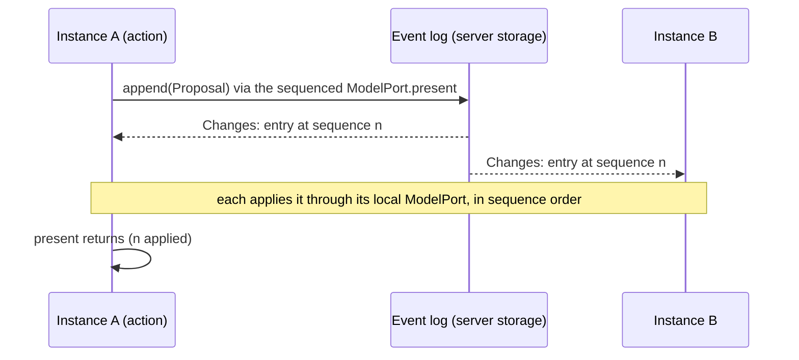

# The SAM loop

Living document. Source of truth: `packages/core/src/Definition.ts`, `Step.ts`, `History.ts`, `Layers.ts`, `Persistence.ts`, `Sync.ts`, `Nest.ts`.

## Definition

```ts
define({ name, model, proposal, intent, representation })({
  controlStates, initial, acceptors, reactors, state, nap, actions
})
```

| Field | Kind | Contract |
|---|---|---|
| `model`, `proposal`, `intent`, `representation` | `Schema` without decoding/encoding services | every cut point is serializable and recordable |
| `representation["Type"]` | must contain `controlState: string` | SAM's control state; also the Stately `value` |
| `controlStates` | `ReadonlyArray<string>` | the states the test model must reach |
| `initial` | model value | seq 0 of the history |
| `acceptors` | `(model, proposal) => model`, pure | folded in declared order; each handles its tags and returns the model unchanged otherwise |
| `reactors` | `(model) => model`, pure | folded after the acceptors |
| `state` | `(model) => representation`, pure | derives the control state |
| `nap` | `(representation) => Option<intent>`, pure | the next automatic action |
| `intentKey` | `(intent) => string`, pure, optional (default `intent._tag`) | automatic intents with the same key are not run concurrently: the drain skips one while another of its key is in flight |
| `actions` | `{ [intentTag]: (intent) => Effect<proposal, ActionFailure, R> }` | the only effectful part; `R` is the services they need |

`applyProposal(def, model, proposal)` is the whole pure step: acceptors, then reactors.

## One step



`layerModelLocal` holds the only mutable state of the framework: the model, the representation (a
`SubscriptionRef`), the record array and a `PubSub` of records. Every mutation runs under one
permit, so steps and travels are serialized and replay is sound.

`layerModelLocal(def, ports, options?)` and `layerLoopLocal` take `options.initial`, an
already-decoded `ModelOf<D>`: seq 0 (`init`) and the first representation come from it instead of
`def.initial`, and `travelTo(0)` returns to it. Decoding untrusted input (a snapshot embedded in a
page) into that model is the caller's job, at its composition root.

## Automatic actions

- An intent from `nap` has origin `auto`; one from a user or driver has origin `user`.
- `ActionsDrain` skips an `auto` intent whose key (`intentKey`, default its tag) has an action still
  running. User intents are never deduplicated.
- The key is released as soon as the action has its proposal, before presenting it, so the `nap`
  of that step can start the next round.
- A user intent's envelope carries the services of the fiber that dispatched it (`context`), and the
  drain runs its action with them: this is how a server's per-request identity reaches an action
  through the queue. Those services are the ports' `R`: it is in the `R` of `IntentBus.dispatch`,
  `IntentPort.dispatch` and `ActionRunner.run`, so a dispatcher that does not provide them does not
  compile. An automatic intent carries an empty context, so an automatic action never acts as
  whoever presented the last proposal, and one that needs a per-request service dies.
- `AutoActions` (`Context.Reference<boolean>`, default `true`) set to `false` drops every `auto`
  intent. Path tests and a server under test use it so ticks cannot move the model between steps.
  Under `layerLoopSynced` an `AutoActionsGate` also has to be open, which only the holder of the
  instances' lease is (see [the lease](#the-lease)): `true` there means the instance takes part.

### Travel and actions in flight

**Rule: `travelTo` interrupts every automatic action in flight; none of them presents afterwards.**
An automatic action is computed from a state the travel has just left, so its proposal is stale by
construction (a pending `Tick` would move `now` back to wall time). The model does this itself,
under its permit, before it appends the `travel` record: the bus owns the fibers of automatic
actions (`IntentBus.runAuto`) and the model calls `IntentBus.interruptAuto`. A `travelTo` that
fails with `NoSuchStep` interrupts nothing.

- The key of an interrupted action is released, so the first step after the travel can start the
  next automatic round. The travel itself does not run `nap`.
- The rule needs no proposal tagging and no extra RPC payload: an automatic intent is always
  emitted by a local model's `nap` onto the bus next to it, so the fibers and the model that
  interrupts them live in the same process in every placement.
- A state that only `nap` can leave is a dead end after a travel and with `AutoActions` false, so the
  view of every such state offers the same intent as a user control. The auction's `opening`
  disables the bid form and shows **Open auction**, which dispatches `Open`; user intents run
  whatever `AutoActions` says and are not interrupted by a travel.

| Placement | Where `nap`, the bus and the model live | What the travel interrupts |
|---|---|---|
| browser only | browser | the local action fiber |
| server actions (local model, remote actions) | browser | the fiber awaiting `Dispatch`; interrupting it cancels the RPC call |
| server model (remote model, local actions) | server (its own loop) | the server's action fibers; the browser's drain only runs user intents |
| server owned | server | the server's action fibers |
| worker | the worker (its own loop, reached through `TravelTo`) | the worker's action fibers |

- User actions are explicit commands, not derived from the state that was left: a user action
  running during a travel still presents its proposal.

## Failures

| Situation | Representation | Where it goes |
|---|---|---|
| Business rejection | a proposal (`BidRejected`) | accepted into the model like any other |
| `ActionFailure` | typed error of the action | logged with `Effect.logWarning`; model untouched |
| Defect in an action or in `present` | `Cause` | logged with `Effect.logError("action died", intentTag, cause)`; the fiber ends, the drain keeps consuming intents |
| Unknown or evicted step in `travelTo` | `NoSuchStep` | returned to the caller |
| RPC call written to a transport that is then lost | defect | not a domain outcome; inside an action or `present` the drain logs it as above. A call made while the transport is down is held and sent after the reconnection; remote streams resubscribe |

Interruption (a travel, or the scope closing) is not a defect and is not logged.

## History and time travel

- Records: `{ seq, at, kind: "init" | "step" | "travel", proposal: Option, model, representation, travelledTo? }`.
- `travelledTo` is the seq whose model and representation a `travel` record restored (an
  `Schema.optional(Schema.Int)`); it is absent on `init` and `step` records, and the `History` RPC
  carries it because it is part of `stepRecordSchema`.
- `records` streams every retained record, then live ones, in seq order and without duplicates; a
  subscriber that lags more than the retained records skips the evicted ones (below).
- `travelTo(seq)` sets model and representation from that record, appends a `travel` record with
  `travelledTo: seq`, interrupts automatic actions in flight (above) and does **not** run `nap`;
  automatic loops resume with the next step.
- `replay(proposals)` appends one `step` record per proposal, in order, as `present` would, but runs
  no `nap` and starts no automatic action; no other proposal falls between them.

### Retention

- `layerModelLocal` keeps the initial record (seq 0) and the newest records up to `HistoryLimit`
  (`Context.Reference<number>`, default 1000), the initial record included in the count. When a
  commit exceeds the limit the oldest records after seq 0 are evicted. A limit below 2 keeps the
  initial record and the newest one.
- Seqs are never reused: the retained records are seq 0 followed by a consecutive window starting at
  the oldest kept seq. `records` replays them, not the evicted gap.
- A subscriber to `records` is bounded too: live records are published through a sliding window of
  `HistoryBacklog` records (`Context.Reference<number>`, default 64) that all subscribers share, so one
  that stops reading holds nothing beyond it. A subscriber that fell out of the window gets the
  records it missed from the retained ones when it resumes (subscribe first, snapshot second, filter
  by `seq`, then close any gap from the retained records), in seq order and once each. Only records
  evicted from retention while it lagged are skipped, so keep `HistoryBacklog` below `HistoryLimit`.
- `travelTo` an evicted seq fails with `NoSuchStep`, like a seq that never existed. Seq 0 is never
  evicted, so a consumer that resets with `travelTo(0)` (the path runner of `@mufw/test`, a replay
  against a long-lived server) always can.

### Export, import and replay

`History.ts` works on a history held as `ReadonlyArray<StepRecord>` (the `records` stream collected).

| Function | Contract |
|---|---|
| `historySchema(def)` | `Schema.Array(stepRecordSchema(def))` |
| `encodeHistoryJson(def)(records)` | `Effect<string, SchemaError>`: the JSON text of the history (`Option` as `{"_tag":"None"}` / `{"_tag":"Some","value":…}`) |
| `decodeHistoryJson(def)(json)` | `Effect<ReadonlyArray<StepRecord>, SchemaError>`: the only place untrusted history text is parsed; malformed JSON or a record that does not match the definition's schemas fails with a `SchemaError` |
| `replayFrom(def, records, seq)` | pure, `Result<ReadonlyArray<StepRecord>, NoSuchStep>`: starts from the model of record `seq`, re-applies the proposal of every later `step` record with `applyProposal`, and returns the recomputed records (recorded `seq`, `at` and proposal; recomputed model and representation). `NoSuchStep` when `records` has no record `seq` |
| `replayInto(ports, records, seq)` | `Effect<void, NoSuchStep \| ReplayBaseMismatch, ModelPort \| HistoryPort>`: `HistoryPort.travelTo(seq)`, a check that the live representation equals the one recorded at `seq` (`Equal.equals`), then `HistoryPort.replay` of each later recorded proposal, in order; nothing else of the loop is touched |

- Only `step` records are replayed; a `travel` record after `seq` is skipped. The loop appends a
  `travel` record and one `step` per proposal under its own next seqs, so a recorded
  `travelledTo` cannot be honoured.
- `replayInto` fails with `NoSuchStep` before touching the ports when `records` has no record `seq`,
  and with the port's `NoSuchStep` when the loop no longer retains it (seq 0 is always retained).
- `travelTo(seq)` restores what the live loop recorded under `seq`, not what `records` recorded: an
  imported history, or a loop that has moved on, can hold another model there. `replayInto` then
  fails with `ReplayBaseMismatch { seq }` and presents nothing, leaving the loop at the state the
  travel restored. The check compares representations, since the ports expose no model; a model
  difference the representation does not show is not detected.
- `HistoryPort.replay(proposals)` applies the proposals in order, one `step` record each, under one
  hold of the model's permit and without `nap`: `present` runs `nap`, and the recorded history
  already contains the automatic proposals it produced, so presenting them on a loop whose
  automatic actions are on would start those actions again and apply them a second time. With
  `replay`, `replayInto` gives the same result whether `AutoActions` is true or false, and the loop
  starts no automatic action for the state it ends in, as after `travelTo`. A state that only `nap`
  can leave is then left by a user intent or by the next step. `replayFrom` never runs `nap`
  either.
- `replay` is a port operation, so it runs wherever the history port does: locally under the
  permit, over RPC as `Replay` (development only, like `TravelTo`, and as trusting as `Present`),
  and in a worker only if the worker's RPC list includes `Replay` (the auction's serves `TravelTo`
  but not `Replay`). On a synced loop it applies on the instance alone, like `travelTo`: do not
  serve it there.

## Persistence

`Persistence.ts` keeps the **model** (not the history) in an `effect/persistence` `KeyValueStore`.
The store is a port: core only requires the `KeyValueStore` service, and the composition root picks
memory, a directory of files or any other implementation.

| Function | Contract |
|---|---|
| `loadModel(def, key?)` | `Effect<Option<ModelOf<D>>, KeyValueStoreError \| SchemaError, KeyValueStore>`: the JSON text under `key` (default `def.name`) decoded with `def.model`; `none` when the key is absent |
| `layerPersistModel(def, ports, key?)` | background fiber over `HistoryPort.records`: writes `record.model` under `key` for the newest `step` or `travel` record, coalescing the records that commit while a write is in flight. Requires `KeyValueStore`, `HistoryPort` |
| `layerLoopPersisted(def, ports, key?)` | `loadModel`, then `layerLoopLocal(def, ports, { initial })` (`def.initial` when `none`) with `layerPersistModel` on top; provides what `layerLoopLocal` provides, fails like `loadModel` |

- **Parse, don't validate.** Stored text is untrusted: it is decoded once, at load, with the
  model's schema (`Option`s take their canonical JSON form, as in history export). A value that does
  not decode fails the layer with a `SchemaError`, so the loop never starts, and the value is left in
  the store. Falling back to `def.initial` would hide the data loss and the next step would overwrite it.
- **Composition, not a change to the model layer.** `layerModelLocal` still knows nothing about
  storage; the writer reads the same `records` stream as devtools and `@mufw/rpc`. The `init`
  record is not written (it is the model just loaded, or `def.initial`), so a loop that never steps
  leaves the store as it was; `travelTo(0)` writes the restored model like any travel.
- **Writes are off the permit.** A step commits, releases the permit and only then reaches the
  writer through the records `PubSub`; a slow store never slows `present`. Writes run in commit
  order on one fiber.
- **Only the newest model is written.** The writer's input is a sliding buffer of capacity 1 after
  the `init` filter, so it keeps draining the `PubSub` subscription however slow the store is: at
  most the write in flight and one pending record (the newest) exist, and the models of the steps in
  between are never written. With a slow store and a burst of steps the store receives the first
  model and the last one.
- **Durability: last write wins.** The store holds the model of a recent record. Each write
  is uninterruptible, so closing the layer's scope waits for the write in flight rather than abandoning
  it half done (an interrupted `KeyValueStore.layerFileSystem` write leaves an empty file); the pending
  record is dropped at close, not written. A crash loses the write in flight and the pending
  record, nothing older. What a crash or a power loss does to the write in flight is up to the store.
  The example's `layerAtomicFileStore` (`examples/auction/src/persistence.ts`) writes `<file>.tmp`,
  syncs it, renames it onto the key's file, syncs the directory and only then lets `set` succeed. The
  guarantee: a process crash leaves the previous model or the new one, never a torn file; a power
  loss does the same, and a `set` that has succeeded is on disk (the data before the rename, the
  rename before `set` returns), so it is never lost. A platform that cannot open a directory as a
  file (`BadResource`, Windows) skips the directory sync, and then only the data is guaranteed, not
  the rename; any other sync failure is a `KeyValueStoreError` of that `set`. Two instances on one
  store overwrite each other: instances that share a model share a log
  ([Synchronisation across instances](#synchronisation-across-instances)), and each of them has a
  store of its own.
- **A failed write is logged, not fatal.** A `KeyValueStoreError` (or a defect) is logged at error
  level with the record's seq and the writer carries on: the in-memory loop is the source of truth
  while it runs, and the next record's model supersedes the one that was lost. Failing the loop
  would turn a full disk into a stopped auction.
- **What is stored.** Only the model. The history (retention window, seqs, proposals) starts again
  from seq 0 after a restart, with the loaded model as the initial record; `travelTo(0)` returns to it.
  An instance of a synced loop stores something else under the same key: a checkpoint, the log's
  id, a sequence and the model (see
  [Persisting an instance of a log](#persisting-an-instance-of-a-log)); the two records do not
  decode as each other, so a store holding one is refused, not overwritten, by the other loop.

## Synchronisation across instances

`Sync.ts` runs one definition on several servers that converge on one model. The mechanism is
`effect/eventlog`; core only requires the services, and the application picks the transport.

**The log is the sequencer.** Acceptors are pure but not commutative (a bid is accepted or rejected
against the highest bid so far), so the instances must apply the same proposals in the same order.
`effect/eventlog` alone does not give that: `EventLog.write` runs the handler of the writer's own entry
at once and a remote entry's handler later, with the entries that sort after it by the writer's clock
id passed as `conflicts`, and the clients' journals sort by those ids. So the loop does not use the
`EventLog` runtime: it uses the one thing the event-log server fixes for everyone, the order in which
writes reach its `Storage` (`remoteSequence`, assigned inside one transaction). Every client reads
`Changes` in that order, its own entries included.

| Part | Contract |
|---|---|
| `SyncLog` | `Context.Service`: `append(entry)` and `follow(from)`, a scoped subscription to the entries with `remoteSequence >= from` in sequence order, then live ones, every client's own included, that also says which log it follows (`LogId`) |
| `layerLoopSynced(def, ports, options?)` | `layerLoopLocal` over a `SyncLog`. Requires `SyncLog` and the actions' services; provides the five ports and `AutoActionsGate`; fails with `SyncLogMismatch` when the log is not the one `options.resume` names. `options`: `resume` (a `SyncCheckpoint`: `log`, `sequence`, `model`, `lease`), `checkpoints` (a queue offered the checkpoint after each applied entry), `stopped` (a `Deferred` failed with the `SyncLogMismatch` of a running instance), `lease` (`renewEvery` default 5 seconds, `timeout` default 15 seconds) |
| `layerSyncServer(def)` | the `EventLogRemoteRpcs` handlers over the `Storage` in context, one store per definition (`syncStoreId`). Requires `Storage`, `EventLogServerAuthorization` and a `Registry` it builds itself. Only `Proposal` entries (decoded with the definition's `proposal` schema; one that does not decode is refused), `Lease` entries (decoded with the `Lease` schema, likewise) and `Joined` entries have a handler. An entry with another tag is stored undecoded unless the authorization refuses it |
| `layerSyncStorage(def)` | the event-log `Storage` over a `KeyValueStore`: the log's id and entries persist, so the log survives its host's restart. Fails when a stored value does not decode |
| `layerSyncAuthorization` | `EventLogServerAuthorization`: any identity may read; a write is refused (`Unauthorized` to the client) unless every entry is a `Proposal`, a `Joined` or a `Lease`. It does not say who may write: the endpoint is for trusted instances only |
| `layerSyncLogStorage(def)` | a `SyncLog` over the server's own `Storage`: the host process appends and reads in-process, in the same transaction and sequence as the RPC writers; the log's id is the storage's |
| `layerSyncLogClient(def)`, `layerSyncLogRemote(def)` | a `SyncLog` over `EventLogRemote.makeUnencrypted` and a generated identity; the first needs `EventLogRemoteClient`, the second the client `RpcClient.Protocol` (websocket, `RpcSerialization.layerSchemaBinary`: entries are binary) |
| `layerLoopSyncedPersisted(def, ports, options?)`, `loadCheckpoint(def, key?)` | `layerLoopSynced` that resumes from the stored checkpoint and stores one after each applied entry (see [below](#persisting-an-instance-of-a-log)); requires `KeyValueStore` and `SyncLog` |
| `AutoActionsGate` | `Context.Service` with `open: Effect<boolean>`: the actions drain asks it each time an automatic intent is about to start and drops the intent unless it is open and `AutoActions` is true. `layerLoopSynced` provides it, open while the instance holds the lease |
| `leaseOutcome`, `applyLease`, `LeaseState`, `Lease`, `noLease`, `LeaseTimings` (`SyncLease.ts`) | the pure rule every instance applies to lease entries, the schemas of the lease in the log and in a checkpoint, and the timings (`renewEvery`, `timeout`) that `options.lease` takes |



- **Two model ports.** The layer builds a local model (`makeLocalModel`, the model `layerModelLocal`
  provides, with a read of the model it holds) that only the applier reaches, and exposes under the
  definition's own keys a `ModelPort` whose `present` appends and awaits, and whose `representations`
  are the local model's. The drain, the `Present` RPC and every other caller see only the sequenced
  port, so model mutation stays in the local model under its permit and an instance cannot apply what it
  produced before the log has ordered it. The applier alone calls the local model's `present`.
- **No echo.** The applier presents to the replica, never to the exposed port, so an entry read from
  the log is not written back; each proposal is applied exactly once per instance.
- **`present` returns once the instance has applied the proposal**, not once the log accepted it: the
  caller then reads its own write.
- **A lost connection is not a failure of `present`.** A failure of the append that is not an answer
  of the server (the socket dropped with the write in flight, so it is not known whether the log
  stored it) is retried with the same entry, same id, every second: the event-log server drops an
  entry whose id it holds, so the retry cannot store it twice. `present` also returns as soon as the
  entry comes back through the subscription, even if its append was never confirmed. Only the server's own
  answer, an authorization refusal or a payload that does not decode, is a defect. While the log is
  out of reach `present` waits, and so does building the layer: the example's transport holds a
  request made while the socket is down until the next connection (`layerHoldRequestsWhileDisconnected`),
  so an instance started while the host is unreachable has its port open but answers nothing, every
  request hanging, until it has reached the log and replayed it.
- **What is guaranteed.** Instances that start from `def.initial` or from a checkpoint of the log,
  read the log from the entry after it and apply nothing else end with equal models after the same
  entries, whatever clocks they have: the order is the server's arrival order, not the entries' ids.
  `core/test/Sync.test.ts` shows it for two proposals formed on different instances and logged in the
  opposite order, and for an instance resumed from a checkpoint against one that replayed the log.
- **Actions stay local.** An intent runs its action (credit check, identity, clock) on the instance
  that received it; only the proposal travels, with everything the acceptors need (`at`, `now`). An
  acceptor that reads anything else is not deterministic across instances.
- **Catch-up: replay from the first entry, or from a checkpoint; no snapshot of the log itself.** Without
  `options.resume` the layer starts the applier at sequence 0 from `def.initial` and appends a `Joined`
  entry; with a checkpoint it starts from the checkpoint's model at the entry after its sequence,
  and only then appends it. The layer is built once that entry has been applied, and entries are
  applied in order, so everything the log held when the instance joined is in its model before it
  serves. The cost is the log's length, or the length of its tail past the checkpoint. A `Joined`
  entry changes no model; it is the marker of that moment. An instance with `AutoActions` true then
  takes part in the lease, which is also decided before the layer is built when nobody has claimed it.
- **The log has an identity, and an instance reads only the log it joined.** Sequences mean something
  within one log only. The server's `Storage` has an id (`Storage.getId`, 16 random bytes generated when
  the log is created and kept with it); `LogId` is its lowercase hex. `SyncLog.follow(from)` answers
  with the id of the log it subscribed to (the host's process reads its storage; a client asks the
  server, `EventLog.Hello`, after the subscription is open, so a server replaced in between has already
  dropped the connection the subscription is on). The loop takes the id at its first subscription, or
  from the checkpoint it resumes, and every later subscription must report the same one. Another id is
  a `SyncLogMismatch` and nothing from that subscription is applied. Before the layer is built the
  build fails with it. Afterwards the applier ends (the resubscription does not retry it; a replica
  that applied another log's entries cannot be reset), an error is logged, `options.stopped` fails with
  the mismatch and `present` dies with it rather than wait for an entry nothing will apply; the
  example waits on `stopped` and ends the process with that error, and an instance restarted without
  a checkpoint joins the new log from its first entry.
- **Resubscription.** When the stream of entries fails (a lost connection) it is subscribed again after
  a second from the next unapplied sequence, so no entry is applied twice or skipped; the log it
  reports is checked against the joined one each time.
- **A proposal that does not decode, or whose acceptor dies,** is logged and skipped; all instances
  skip it alike. Instances of different versions of the definition can disagree.
- **`nap` runs on every instance, and the log decides which one runs its intents**: see
  [the lease](#the-lease). Each instance derives the same next intent from the same model, so without
  a rule the auction would receive a tick per instance and second.
- **What breaks convergence.** `HistoryPort.travelTo` and `HistoryPort.replay` move one instance's
  model away from the log (the example's server refuses `TravelTo` and `Replay` with `MUFW_SYNC`).
  A model restored from elsewhere is not the log's, so the loop takes no `initial`, and the bare model
  that `layerLoopPersisted` stores is not one of the log's. The one model an instance may start from,
  other than `def.initial`, is a checkpoint of the log it joins: the model that applying the log's
  entries up to `sequence` to `def.initial` gave, the log being the one named by `log`, which is why
  `options.resume` carries all three and the layer checks the log's id before it applies anything.
  Instances applying the same log hold the same `seq`, `model` and `proposal` for each record that
  started from the same model; only `at`, the instance's own commit time, differs. An instance that
  resumed has fewer records than one that replayed, with other `seq`s, since its history starts at the
  checkpoint.
- **The log lives in the host's `Storage`.** `layerSyncServer` takes the `Storage` in context, and
  its order of entries is the order in which writes reach it. In memory
  (`EventLogServerUnencrypted.layerStorageMemory`) the log is gone with the process and a restarted
  host starts a new one, with a new id: the instances that joined the old one find it at their next
  subscription and stop. `layerSyncStorage(def)` keeps the log in a `KeyValueStore`, so a restarted
  host serves the same entries at the same sequences under the same id: its instances resubscribe from
  their next sequence and go on. It stores the id under `<name>/log/id` and the entries 256 to a key
  under `<name>/log/<n>` (appending rewrites one such key, not the log), reads all of them when it is
  built, and persists an entry before it publishes it, so no subscriber reads an entry a restart
  would lose. An entry the store refuses is a defect of its writer (a persistence failure to an RPC
  client), never delivered. What a crash leaves is the store's to say (the example's
  `layerAtomicFileStore` syncs each write); a log whose newest entries a store lost can sit behind
  an instance's checkpoint, which is not detected (see `docs/TODO.md`). Session authentication
  bindings stay in memory: an instance has a new identity each time it starts, so none would be read
  again.
- **The log is for trusted instances only.** Whoever can write to the event-log endpoint can append any
  proposal that decodes, and every instance applies it: it bypasses the sessions and the credit check
  of the RPC that would have produced the proposal, the way `Present` does on one server. The write is
  open to every identity because the server's authorization interface sees only a generated public
  key, never the connection, so a shared secret has nowhere to be checked.
  `layerSyncAuthorization` still refuses entries of events the log does not hold, and the example
  serves the endpoint on a listener of its own (`MUFW_SYNC_PORT`) on a router of its own, bound to
  `127.0.0.1` unless `MUFW_SYNC_HOST` says otherwise, never on the public port.

### The lease

`nap` runs on every instance, since every instance applies every proposal, and each derives the same
next intent from the same model. Automatic actions must still run on one instance only, or the auction
would receive a tick per instance and second. Which instance runs them is decided by the log itself
(`SyncLease.ts`, `Sync.ts`), so every instance agrees without agreeing on a clock.

- **A `Lease { epoch, holder }` entry is a claim or a renewal, and changes no model.** `holder` is an
  `InstanceId`: 16 random bytes, new for each build of the layer. Lease entries make no history record,
  are not proposals, are accepted by `layerSyncAuthorization`, are decoded with the `Lease` schema by the
  server (one that does not decode is refused) and by every instance (one that does not is logged and
  skipped, alike everywhere), and persist in the log like `Joined`.
- **One rule, applied in log order (`leaseOutcome`).** The state is the epoch of the last claim that won
  and its holder; a log nobody has claimed is epoch 0. A claim for epoch *e*+1 wins if the current epoch
  is *e*; a claim for any other epoch, which includes a second claim for an epoch that already has its
  holder, is ignored. A renewal, an entry for the current epoch, counts only from the current holder;
  any other is ignored, so a deposed holder's late renewals change nothing. Instances apply the same
  entries in the same order from the same state, so exactly one holder exists at each position of the
  log, and two instances that claim at the same moment end with the one whose claim the log ordered
  first.
- **An instance runs automatic actions only while it holds the lease.** `layerLoopSynced` provides an
  `AutoActionsGate`, open while the state names this instance, and the actions drain drops an automatic
  intent unless the gate is open and `AutoActions` is true. `nap` still runs on every instance; its
  intents are dropped on the others. When an instance applies its own winning claim it runs `nap` again
  for the state it is in, since the intent `nap` returned until then was dropped, so a takeover continues
  the tick loop instead of waiting for the next proposal.
- **Taking the lease away stops the old holder at once.** The instance that applies an entry that
  makes another instance the holder interrupts its automatic actions in flight, before it applies the
  next entry, as `travelTo` does; the interrupted action does not present. Automatic intents that
  `nap` returns afterwards are dropped by the gate.
- **Who claims, and when.** `AutoActions` true means the instance takes part in the lease; false means it
  never runs automatic actions and never claims, though it applies lease entries. A participant that
  finds a log nobody has claimed appends the claim for epoch 1 right after its `Joined` entry and the
  layer is built once it is applied. Afterwards a keeper fiber wakes every `renewEvery` (5 seconds):
  the holder appends a renewal; any other participant appends a claim for the next epoch if it has
  applied no claim or renewal for `timeout` (15 seconds) by its own `Clock`. The silence clock starts
  when the instance has caught up, not at the age of the entries it replayed, so an instance that
  starts late does not mistake an old log for a silent holder. A failed append is logged and the next
  turn tries again; a claim that arrives late and finds the epoch taken is ignored.
- **A restarted instance holds nothing until it wins an epoch.** The identity is new with each layer, so
  the lease its earlier run held belongs to a holder that no longer exists and expires like any other:
  a lone instance that restarts takes the lease back after the timeout. The lease state is part of the
  checkpoint, so a resumed instance applies the entries after `sequence` against the epoch they were
  written under.
- **The window of a deposed holder.** An action that has finished and appended its proposal before its
  instance applies the entry that deposed it is in the log and is applied by everyone, as any entry
  before a later one is: leases bound the duplication to the time an instance takes to hear of its
  loss (a partition, a pause), they do not fence the proposals of a holder that has not heard.
- **`core/test/SyncLease.test.ts`** shows it over the in-memory log with `TestClock`: one ticker for two
  participants, takeover after the timeout when the holder's scope closes, a single winner of two
  simultaneous claims, a holder cut off from the log that is deposed, loses its action in flight and
  claims a later epoch, and a checkpoint that carries the lease. `pnpm --filter @mufw/example-auction
  test:sync:failover` shows it across processes.

### Persisting an instance of a log

`layerLoopSyncedPersisted(def, ports, options?)` (`Persistence.ts`) is `layerLoopSynced` that resumes
from a stored checkpoint and stores one after every entry it applies. `layerLoopSynced` stays unaware
of storage: it offers the checkpoint to a sliding queue of capacity 1 (`options.checkpoints`) and a
fiber of the persistence layer writes it, so the write is off the permit and coalesced as in
`layerPersistModel` (the write in flight finishes, the pending checkpoint is dropped at close, and a
failed write is logged, not fatal).

- **The record is `{ log, sequence, model, lease }`**, decoded once with a `Schema` at load
  (`loadCheckpoint`): the id of the log, the last sequence of it whose entry the model includes, the
  model, which is the instance's own after applying that entry, and the lease those entries give (epoch
  and holder, see [the lease](#the-lease)). It is stored under the definition's name (or `options.key`)
  as JSON text. A text that does not decode, so a model stored by `layerPersistModel`, which is not the
  state of any log, or a checkpoint stored without a `lease`, fails the layer with a `SchemaError` and is
  left as it was. The lease is in the record because the instance reads only the entries after
  `sequence`: a renewal or a claim there means something only against the epoch the entries before it
  left.
- **A joiner replays only the tail.** The loop starts from the stored model and reads the log from
  `sequence + 1`. Entries between the checkpoint and the log's end are applied in order, so the
  instance ends where an instance that replayed the whole log ends (`core/test/Sync.test.ts`,
  `SyncPersistence.test.ts`). A checkpoint a write behind is harmless: the instance reads a few more
  entries.
- **A checkpoint of another log is refused, not replayed over.** When the log's id is not the stored
  one the layer fails with `SyncLogMismatch` and the record is left as it was. Starting from
  `def.initial` instead would be correct for the log but would discard a stored model without saying
  so, as falling back on a stored value that does not decode would; the operator who knows the log was
  replaced deletes the record, and the instance then replays the new log from its first entry.
- **A checkpoint is trusted, not recomputed.** It is the log's state only for the acceptors that
  produced it: after a change to the definition's acceptors, delete the records, so that the log is
  replayed with the new ones.
- **Each instance has a store of its own.** Two instances on one store directory overwrite each
  other's checkpoint. The host's directory also holds its log (`layerSyncStorage`); a joiner's holds
  only its checkpoint. That is what the example's `MUFW_STORE` names, with `MUFW_SYNC=host` or
  `MUFW_SYNC=ws://…` alike.

## Nested definitions

`nest(parent, child, options?)` (`Nest.ts`) is a pure function from two definitions to one, for
wizards and forms: the result is an ordinary `SamDefinition`, so one loop, one history and one
graph cover both sides, and every placement and tool takes it unchanged.

| Part of the result | Contract |
|---|---|
| `name` | `options.name`, default `${parent.name}/${child.name}` (ports are keyed by name) |
| `model` | `{ parent, child }`; `initial` combines both sides' |
| `proposal`, `intent` | the parent's union, unwrapped, plus `{ _tag: "Child", proposal }` / `{ _tag: "Child", intent }` carrying the child's. A parent that already has a `Child` proposal or intent tag is an authoring bug: `nest` throws |
| `representation` | `{ controlState, parent, child }`; `controlState` is `options.controlState(parent, child)`, default the parent's |
| `controlStates` | `options.controlStates`, which must list every value `controlState` can take (required with `options.controlState`, enforced by its type); default the parent's. The representation schema decodes only these |
| `acceptors`, `reactors` | each side's own, routed by wrapper: a parent acceptor sees only `model.parent` and the unwrapped parent proposals, a child acceptor only `model.child` and the payload of `Child` proposals. Reactors run per side after all acceptors |
| `nap` | the parent's intent if `Some`, else the child's wrapped in `Child` |
| `intentKey` | a child intent is keyed `Child/` plus the child's own key, so two different automatic child intents run concurrently and a repeated one is still skipped; a parent intent keeps the parent's key |
| `actions` | the parent's, plus `Child`, which runs the child's action for the wrapped intent and wraps the proposal it returns |
| services | `ServicesOf<parent> \| ServicesOf<child>` |

Forwarding makes the sides react to each other without a second step. `options.toChild(proposal)`
receives every accepted parent proposal and `options.toParent(proposal)` every accepted child
proposal (unwrapped); a `Some` is applied to the other side's acceptors inside the same
`applyProposal`, so the history gets one record and `Present` carries one proposal.

- Forwarding is one hop. The forwarded proposal goes through the other side's acceptors only; it
  is neither forwarded back nor offered to `toParent`/`toChild` again, so two sides forwarding to
  each other cannot loop.
- Forwarding acceptors run after the routed ones, and the reactors after all of them: a forwarded
  proposal lands on a side that already took its own, and each side's reactors see the final model.
- `toChild`/`toParent` see the proposal, not the model.
- The drain skips an automatic intent whose `intentKey` is already in flight. A child intent's key
  carries the child's own key (`Child/ClearA`), so `nap`'s next child intent of another kind is not
  held back by a slow child action; a child intent of the same kind is skipped, as in a flat definition.

A nested definition can be the child of another `nest`; as a parent it already has the `Child` tag,
so `nest` throws. Its graph is explored like any other: with a combined `controlState`
(`"low/high"`) the nodes are the combinations of both sides' states.
